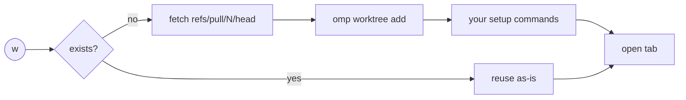

<div align="center">

# ⎇ Tern Plotroom

**Your GitHub PR queue, inside [Tern](https://docs.stencil.so/tern).**
Triage with the keyboard. One key checks a PR out into its own worktree. Another points an agent at it.

[](https://github.com/andyhite/tern-plotroom/actions/workflows/check.yml)


</div>

```
 ┌─ Plotroom · GitHub PRs ──────────────────────────────────────────── ⚙ ↻ ─┐
 │ Filters          │  #482  fix: debounce search input         ✓ 3/3  In tab │
 │ ▸ Needs review   │  #479  feat: worktree setup commands       ● 1/4        │
 │   Mine           │  #471  chore: bump luau-lsp                ✓ 2/2  Wtree │
 │   Drafts         │  #468  docs: README, but fancy             ○ 0/1        │
 │                  │                                                         │
 │ Auto-refresh: every 60 s, next 14:02:11  ·  4,991 / 5,000 until 14:30     │
 └──────────────────────────────── ?  keys  ·  /  search  ·  w  worktree ─────┘
```

## Install

Requires Tern 0.8.3, `gh` signed in to github.com, `git` ≥ 2.36 and [`omp`](https://github.com/can1357/oh-my-pi) (worktrees and agents).

```sh
tern plugin install github.com/andyhite/tern-plotroom/plugin
```

Then, in a pane inside any github.com checkout: palette → **Plotroom: Open GitHub PRs**.

Update later with the same command plus `--force`.

**Remote hosts.** A Plotroom pane on a remote host works like a local one: the queue, worktrees and agents run on that host, with its `gh`, `git`, `omp`, checkouts and saved settings. Install the same Plotroom version on both machines (the command above, run on each). With a different version on the remote, the Worktree and Agent actions say so instead of running.

## What it does

| | |
| --- | --- |
| 🔍 **Saved filters** | Any GitHub search query, scoped to the repo you launched from. |
| ⚡ **Polite refresh** | Every 60 s while quota is ample; backs off from GitHub's rate-limit headers instead of hammering. |
| ✅ **Checks** | The selected PR's full check list, re-runs collapsed to the newest. Reloaded on every successful refresh, so check status changes show up even when the PR itself is unchanged. |
| 🌳 **Worktrees** | `w` checks the PR out with `omp worktree add` into omp's worktree directory (default `~/.omp/wt`) as `plotroom-<owner>_<repo>-pr-N`, and opens a tab there. Never resets, cleans or deletes anything of yours. |
| 🤖 **Agents** | `a` runs an [omp](https://github.com/can1357/oh-my-pi) prompt template or skill on the PR, inside its worktree. |
| 👤 **Per-repo accounts** | Work and personal `gh` logins on one machine. Tokens stay in memory, never on disk. |

## Keys

Press `?` in the block for this list.

| Key | Does |
| --- | --- |
| `↑` `↓` / `j` `k` | Move |
| `Tab` | Switch between filters and PRs |
| `Enter` | Open the PR in a Browser block beside the queue |
| `w` | Create or reuse the PR's worktree in a new tab |
| `g` | Go to the tab already working in that worktree |
| `a` | Run an agent on the PR |
| `/` | Search loaded PRs |
| `r` | Refresh now |
| `s` | Settings: filters, GitHub account, worktree checkout path and setup commands |

## Worktrees



- Worktrees go in omp's worktree directory: `OMP_WORKTREE_DIR`, else omp's `worktree.base` setting, else `~/.omp/wt`. The Settings checkout path is only the repository the worktree is added from.
- Branch `plotroom/<owner>/<repo>/pr-N` tracks `refs/pull/N/head`, so `gh pr view` and `git pull` work inside it without arguments.
- Reused worktrees are never updated. The preview shows `Created|Reused · Current|Different · Clean|Modified` and offers the `fetch` + `merge --ff-only` and cleanup commands for you to run.
- Plotroom never runs `reset`, `clean`, `stash`, `worktree remove`, `prune`, `branch -d`, or `update-ref -d`.
- **Setup commands** (Settings › Worktrees) run in the new tab's shell when a worktree is *created*. They execute the PR's code (`pnpm install` runs its scripts), so leave them empty for repos that take untrusted PRs.

## Trust

- No shell: `gh`, `git`, `ssh -G` and `omp` run as argv arrays. If they are not on Tern's PATH, your login shell is run once to find them.
- No secrets on disk. `kv.json` holds filters, checkout paths, setup commands, logins and recent agent picks in plaintext.
- A saved account that cannot be used **fails closed**: nothing falls back to your active `gh` login.
- Agents read PR text written by whoever opened the PR. Be careful with agents that can act.
- **Agents can run project code.** `omp` loads the project configuration of the directory it starts in (extensions, hooks, MCP servers), not only your setup commands. That code is trusted once you allow it, not sandboxed. Plotroom asks first, every time, with Cancel as the first choice and nothing remembered:
  - before listing agent commands, which runs `omp` in the directory Plotroom was launched from (skipped when that is your home directory). Cancelling runs no `omp` there;
  - before starting an agent, naming the PR's worktree. It is asked once the worktree exists and before `omp` runs in it, setup commands run or the agent starts. Cancelling leaves the worktree as created and runs no `omp` in it, no setup commands and no agent, so the PR's project configuration is not executed.
- **Templates are checked against omp.** A prompt template is sent as `/name <PR URL>` and omp expands it. After you continue, Plotroom runs `omp config path` and omp's own command discovery in the PR's worktree, across every source and alias, and refuses to start the agent if:
  - omp lists any command or alias with the template's name, or cannot answer;
  - the template file changed or vanished since it was listed;
  - a `<name>.md` under the checkout's `.omp/prompts` (or the config directory omp reads there, if the checkout redirects it) differs from the file you picked, or the PR's own template is missing.

  Skills, omp file commands and typed prompts are not checked this way: for those, your confirmation is the only guard.

SSH aliases (`git@github.com-work:…`) count as GitHub when `ssh -G` resolves them to `github.com`.

<details>
<summary><b>Finer points</b> (refresh, partial results, accounts, ref names, errors)</summary>

**Refresh.** Up to 10 requests of 100 results per refresh (GitHub's 1,000 cap). Interval is 60 s with ample quota; otherwise time-to-reset is spread over 80 % of remaining requests across open panes, never under 60 s. Quota 0 or `Retry-After` pauses everything until reset. A failed page discards that refresh and keeps the last complete result marked `stale`. Terminal errors (`gh` missing, not signed in, HTTP 422, unusable account) stop auto-refresh until you press `r`.

**Filters.** `repo:`, `org:`, `user:` and bare `OR` are rejected: every filter stays inside the launch repo (first github.com remote: origin, upstream, then alphabetical).

**Accounts.** The GitHub settings page sets a `gh` login per repo. Each `gh` call then runs `gh auth token --user <login>` and passes the result as `GH_TOKEN` to that one child. Manage logins with `gh auth login` / `gh auth switch`.

**Refs.** Fetches land in `refs/plotroom-pr/<owner>/<repo>/pr-N`. Names git refuses (`.github`, `a..b`) are `%2E`-encoded in branch and ref only; the directory keeps the raw name.

**Errors you can act on.** Branch exists elsewhere with no worktree: the message gives the `worktree add` command. Target directory exists but is not this PR: move it. Locked or prunable record: `git worktree repair` or `prune`. Tab did not open: press `w` again, it reuses.

</details>

## Development

```sh
git clone git@github.com:andyhite/tern-plotroom.git && cd tern-plotroom
tern plugin link ./plugin          # live-reloads on edit; never link the repo root (.git churn)
python3 scripts/check.py tools     # pinned luau + luau-lsp
python3 scripts/check.py           # test · types · bench · smoke
```

| | |
| --- | --- |
| `plugin/host.luau` | the `prs` block: queue, filters, refresh, state; worktrees and agent menus for the window, run where the block runs |
| `plugin/window.luau` | links, palette commands, the pickers and tabs of the worktree and agent flows |
| `plugin/github.luau` · `worktree.luau` · `agent.luau` · `process.luau` · `input.luau` | `gh` search, worktrees, omp templates and skills, argv process runner, text input |
| `plugin/tests/` | `regression.luau` (fake SDK), `check.luau` (pure asserts), `runtime.luau` (real-Tern smoke) |
| `scripts/check.py` | the gate; CI runs `--ci` (no smoke, Tern is not available there) |

`link` and `install` are exclusive per id: switch with `tern plugin remove plotroom` / `tern plugin unlink plotroom` first.
