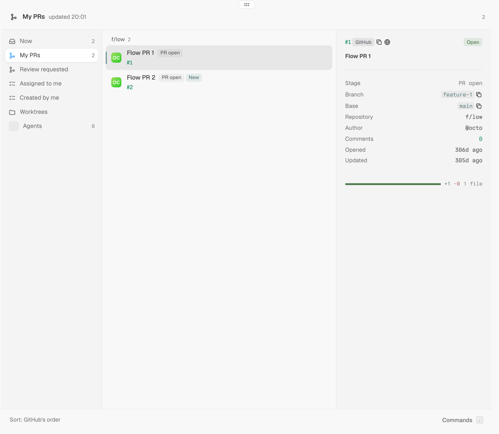
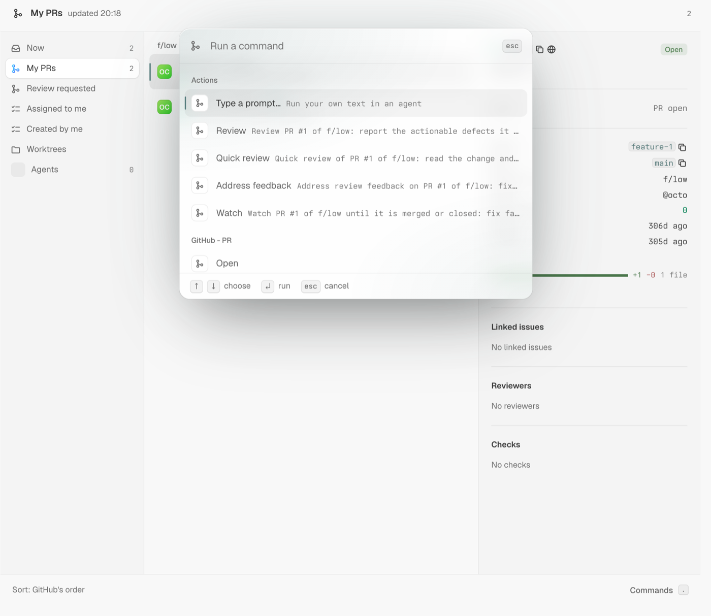
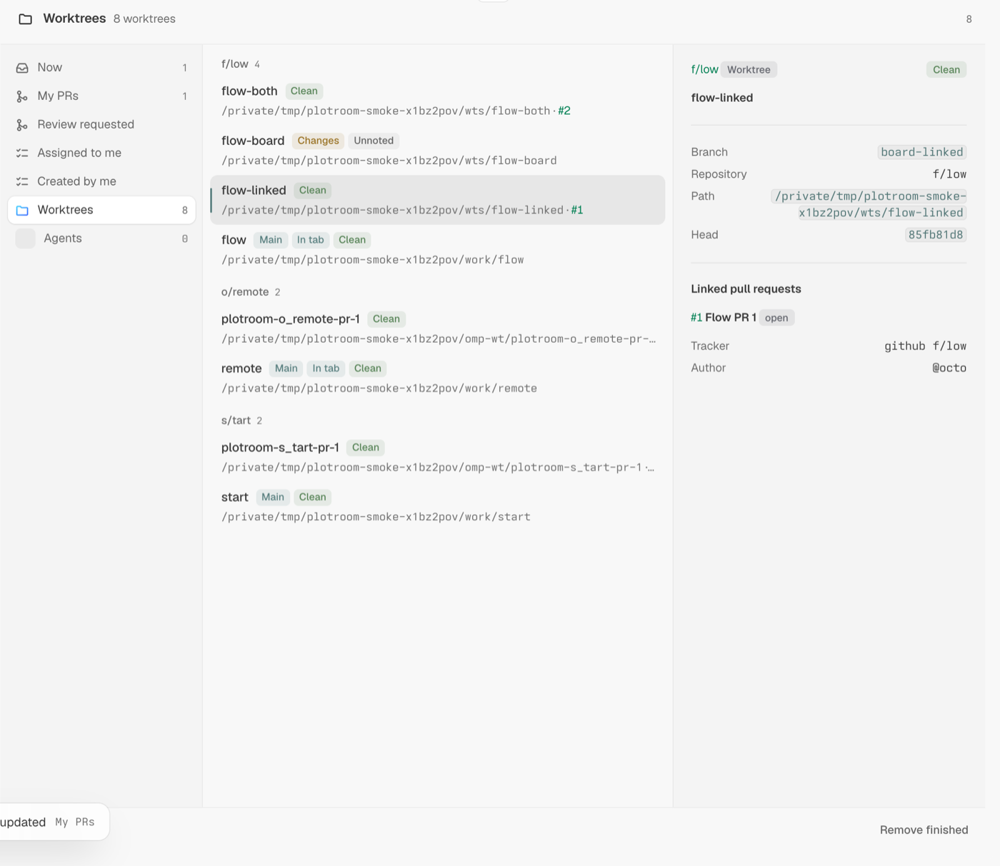
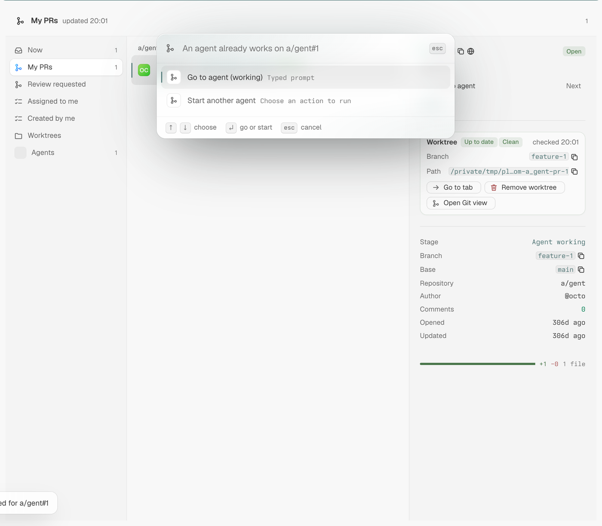

<div align="center">

# ⎇ Tern Plotroom

**Your pull requests and issues, in one block inside [Tern](https://docs.stencil.so/tern).**
Triage with the keyboard. One key checks a PR or issue out into its own worktree. Another points an agent at it.

[](https://github.com/andyhite/tern-plotroom/actions/workflows/check.yml)


</div>



## Who it is for

You work in [Tern](https://docs.stencil.so/tern) with [omp](https://github.com/can1357/oh-my-pi) and run a few coding agents at once against GitHub pull requests and issues, sometimes Jira issues. Plotroom is where you decide what to work on, hand it to an agent, and land it, without keeping the state in your head. It is keyboard first, works the same on a remote host, and keeps a work and a personal GitHub login apart.

It is not a team tool, a hosted service or a full GitHub or Jira client: GitHub, Jira, Tern and omp keep doing what they do well, and Plotroom ties them into one loop.

## The loop

| Step | Your question | Plotroom answers with |
| --- | --- | --- |
| **Intake** | What work exists? | Views of GitHub searches and Jira JQL, Pins for any item by URL, GitHub notifications in Now |
| **Triage** | What needs me now? | Now, ranked with why; stages, New and Changed badges, Snooze, checks and reviews in the preview |
| **Dispatch** | Who does it, and where? | One-key Worktree, actions that start an omp agent in it |
| **Supervise** | Which agent needs me, and which finished? | Agent states on every item, the Agents list, Message, Interrupt and Stop agent |
| **Land** | Is it ready? Ship it. | Merge, Approve, Request changes, Update branch, Draft PR, each confirmed first |
| **Clean up** | What is finished? | Find finished worktrees and remove them, never forced |

Commands (`.`) lists everything that applies to the selected item:



Worktrees lists every worktree of your checkouts straight from git, with the item it belongs to:



An action starts an agent in the item's worktree. While it works, the item says so, and starting another action on it offers Go to agent first:



## Install and first run

Requires Tern 0.9.8, `git` ≥ 2.36 and [`omp`](https://github.com/can1357/oh-my-pi), plus `gh` signed in to github.com for GitHub and Atlassian's [`acli`](https://developer.atlassian.com/cloud/acli) for Jira.

```sh
tern plugin install github.com/andyhite/tern-plotroom/plugin
```

1. Open the repository you work on in a Tern tab.
2. Tern's palette → **Plotroom › Open** (or press ⌃⌥⇧Q).
3. Follow **Get started** above the preview: it lists what is left before an agent can run (`gh`, `omp`, a checkout, the one-key shortcuts), one action per line.
4. Select an item and press **Worktree**, or pick an action from Commands (`.`): the agent starts in the item's worktree.

Update later with the same install command plus `--force`.

## More

- [Reference](docs/reference.md): everything Plotroom does, step by step through the loop.
- [Trust](docs/reference.md#trust): what Plotroom runs, stores and confirms, and what agents may do.
- [Development](#development): building, testing and the code layout.
- [PRODUCT.md](PRODUCT.md) and [CHANGELOG.md](CHANGELOG.md): where Plotroom is going, and what changed.

## Development

```sh
git clone git@github.com:andyhite/tern-plotroom.git && cd tern-plotroom
tern plugin link ./plugin          # live-reloads on edit; never link the repo root (.git churn)
python3 scripts/check.py tools     # pinned luau + luau-lsp
python3 scripts/check.py           # test · types · bench · smoke
```

| | |
| --- | --- |
| `plugin/host.luau` | the one `prs` block (shown as Plotroom): the entry point (requires, queue action dispatcher, block handlers with the worktree card helpers, `tern.block.define`) |
| `plugin/host/` | the block's logic, run where the block runs, layered (each requires only those before it): `core` (types, constants, badges, CLI state) · `storage` (kv stores) · `engine` (lifecycle, refresh, triage, pins, worktrees, details) · `render` (rows, previews, help) · `settings` (Settings sheet) · `requests` (window requests, workflows, palette actions) |
| `plugin/window.luau` | links, palette commands, the pickers and tabs of the worktree and agent flows |
| `plugin/flows.luau` | window side of the workflow commands: agent links and status, confirmed mutations, draft PR, open by URL, the item commands |
| `plugin/triage.luau` · `sorting.luau` · `board.luau` | seen/snooze memory, per-view sorts, the Worktrees model |
| `plugin/github.luau` · `jira.luau` · `tracker.luau` · `worktree.luau` · `process.luau` · `input.luau` · `keys.luau` · `prompts.luau` | `gh` search and writes, Jira through `acli`, tracker-neutral issues and name formats, worktrees and their inventory, argv process runner, text input (one line or many), the queue's rebindable keys, the default prompts |
| `plugin/tests/` | `regression.luau` (runner), `harness.luau` (fake SDK, helpers), `cases/` (one file per area), `check.luau` (pure asserts), `runtime.luau` (real-Tern smoke) |
| `scripts/check.py` · `scripts/smoke.py` | the gate (tools, bundle, test, types, bench); CI runs `--ci` (no smoke, Tern is not available there). `smoke.py` runs on installed Tern 0.9.8+ against temporary local repositories and a fake `gh`: worktrees, inventory, draft preview and push, triage/sort/Worktrees, URL, agent lifecycle, selected-text review and the Files entry. |

`link` and `install` are exclusive per id: switch with `tern plugin remove plotroom` / `tern plugin unlink plotroom` first.
