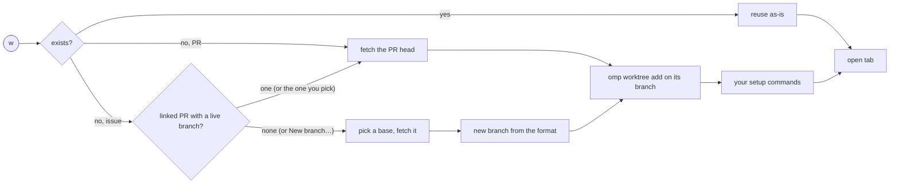

<div align="center">

# ⎇ Tern Plotroom

**Your pull requests and issues, in one block inside [Tern](https://docs.stencil.so/tern).**
Triage with the keyboard. One key checks a PR or issue out into its own worktree. Another points an agent at it.

[](https://github.com/andyhite/tern-plotroom/actions/workflows/check.yml)


</div>

```
 ┌─ Plotroom · My PRs ────────────────────────────────────────────────── ⚙ ↻ ─┐
 │ Views            │  #482  fix: debounce search input         ✓ 3/3  In tab │
 │ ▸ Needs review   │  #479  feat: worktree setup commands       ● 1/4        │
 │   Assigned to me │  #471  chore: bump luau-lsp                ✓ 2/2  Wtree │
 │   Drafts         │  #468  docs: README, but fancy             ○ 0/1        │
 │                  │                                                         │
 │ Auto-refresh: every 60 s, next 14:02:11  ·  4,991 / 5,000 until 14:30     │
 └──────────────────────────────── ?  keys  ·  /  search  ·  w  worktree ─────┘
```

## Install

Requires Tern 0.8.3, `git` ≥ 2.36 and [`omp`](https://github.com/can1357/oh-my-pi) (worktrees and agents), plus the CLI of each integration you use: `gh` signed in to github.com for GitHub, Atlassian's [`acli`](https://developer.atlassian.com/cloud/acli) signed in (`acli jira auth login`) for Jira. An integration is only there while its CLI is installed on the block's host: without `gh`, Plotroom has no GitHub views, groups or prompts, only Settings › GitHub with a **Setup guide** button to gh's install instructions; without `acli`, the same for Jira (Settings › Jira). Install the CLI, then Refresh (or show its setup page again) and the integration turns on.

```sh
tern plugin install github.com/andyhite/tern-plotroom/plugin
```

Then, from any pane: palette → **Plotroom: Open**. One Plotroom block holds every saved view in its sidebar: GitHub pull requests and issues, and Jira issues. Opened inside a github.com checkout, it saves that checkout as the one its worktrees come from (Settings › Repositories).

Update later with the same command plus `--force`.

**From the separate Issues block.** There is no *Plotroom: Open Issues* command any more: Plotroom: Open is the one entry point and shows issue views too. Tern has no way to convert a pane, so a pane of the old Issues block does not work in the new version: close it and open Plotroom once. A pane of the old PR block reopens as it was. Your saved views and prompts are not touched: the new block reads them where they are.

**Remote hosts.** A Plotroom pane on a remote host works like a local one: the queue, worktrees and agents run on that host, with its `gh`, `git`, `omp`, checkouts and saved settings. Install the same Plotroom version on both machines (the command above, run on each); plugins are not updated or synchronized automatically. The plugin's version tracks its protocol (`0.<protocol>.0`), so `tern plugin list` on each host tells whether the two builds speak the same one. With Tern's status bar enabled, a focused Plotroom pane shows **Plotroom protocol mismatch** when its host announces a different protocol. The local window checks on focus and every two seconds while Plotroom stays focused, so the warning clears when the protocols match. A missing marker while the block loads shows no warning. This checks compatibility, not whether two builds have the same release or commit; host-backed actions still refuse an incompatible or missing protocol.

## What it does

| | |
| --- | --- |
| 🔍 **Typed views** | Saved searches in one sidebar, each a **Pull requests** or an **Issues** view. A GitHub view takes a GitHub search query across every repository its login can see (`repo:`, `org:` and `user:` narrow it); a Jira view takes JQL across every project `acli` can see. The sidebar groups the GitHub pull request and issue views together, with Jira views alongside. In a block 127 columns wide or narrower the sidebar folds into a dropdown whose entries read `GitHub - octocat: My PRs` (integration, profile when there is one, then the view) and show no counts. Settings › Views has a group for each `gh` login signed in and one for Jira while `acli` is installed, each with its views and an **Add view** button: the new view searches as that login (or through Jira) and is of the active view's type, an Issues view for Jira. While a group lacks one of the default views, **Restore defaults** beside Add view adds back each default it has none named like, as that group's (an edited default keeps your query). A view's form holds its Type (GitHub views), name, query, grouping and prompts. Changing a view's Type keeps its name and query but not the prompts offered under it. Issue views list In Progress, then To Do, then Done. |
| 🧭 **Default views** | A first run starts with these. Pull requests: **My PRs** and **Team reviews** (requests to a team you are on), **Review requested** (asked of you directly, oldest waiting first) and **Reviewed by me** (open PRs you reviewed that no longer ask you, so you see the author's follow-up), the review queues without drafts. GitHub issues: **Assigned to me** and **Created by me** (assigned to someone else or no one). All GitHub defaults skip archived repositories; those not marked otherwise are grouped by repository. Jira: **My sprint** (by status), **Up next** (not started), **In progress** (by status), **Up for grabs** (unassigned, not started), all in an open sprint; **Assigned to me** and **My epics** (by status) and **Created by me** (assigned to someone else or no one, by assignee). Only My epics lists epics (`hierarchyLevel = 1`); the others take `hierarchyLevel < 1`, whatever your site calls its epic type. The four sprint views come only when the Jira site has sprints: Plotroom asks once `acli` starts (again on Refresh), and Restore defaults offers them once it does. |
| ⚡ **Polite refresh** | Every 60 s while quota is ample; backs off from GitHub's rate-limit headers instead of hammering. |
| ✅ **Checks and details** | The selected PR's full check list, re-runs collapsed to the newest, with its merge state (conflicts, behind base, blocked, ready), each reviewer's latest verdict and who is still requested, and its description folded above the facts. Reloaded on every successful refresh, so check status changes show up even when the PR itself is unchanged. Linked pull requests and issues (an issue's linked PRs, a PR's closing issues, a Jira issue's links) show as their own sections with state and a short excerpt of the description; a link Plotroom cannot read falls back to its name (the file's basename for a path) instead of an error. |
| 🌳 **Worktrees** | **Worktree** checks the PR out on its own head branch with `omp worktree add` into omp's worktree directory (default `~/.omp/wt`) as `plotroom-<owner>_<repo>-pr-N` (the folder name format is yours to change), and opens a tab there. On an issue, it uses the issue's linked pull request's branch, else a new branch from a base you pick. Never resets or cleans anything of yours; the preview's worktree card can remove the worktree, asking first and never forcing it. Needs the repository's local checkout (Settings › Repositories); without one, Worktree, agents and prompts ask for it. |
| 🤖 **Agents** | The command palette's **Saved actions** group: pick a saved action (Settings › Actions) offered under the current view, or **Type a prompt…**, and it starts an [omp](https://github.com/can1357/oh-my-pi) agent block (Tern's `cx.agents:start`) inside the item's worktree (or, as the action says, the repository's main checkout) with that prompt, no questions asked. An action may name the model omp runs it with (`omp --model`): a role alias such as `@slow`, or a model such as `opus`. Give an action a key (Settings › Keyboard shortcuts) to run it straight from the queue. |
| 🔗 **Linked PRs** | On an issue, click a linked pull request to show it in the same block: it is selected in the active view when that lists pull requests and has it; otherwise it is looked up alone under an `owner/name#N` entry at the top of the sidebar, and the other views stay there to go back to. |
| 👤 **Per-view accounts** | Work and personal `gh` logins on one machine: each signed-in login has its own group of views in the sidebar, searching as that login. Tokens stay in memory, never on disk. |

## Keys and the command palette

`.` opens the **command palette**, the one key bound by default. Its rows are grouped and filtered to what applies now, **Saved actions** first (Type a prompt…, the actions offered under the view, and Go to agent while the item has one, plus Interrupt agent, Stop agent… and Message agent… while its agent is live; there is no Agent picker in the menu), then **Jira - Issue**, **GitHub - PR** and **GitHub - Issue** (the selected item's own operations, under the heading of its type: Open in GitHub or Jira, Worktree, Go to tab while the item has a tab, Assign to me, Comment…, Add or Remove label…, Close or Reopen issue…, Ready for review… or Convert to draft…, Jira transition…, Re-run failed checks, Re-run all jobs…, Cancel running workflow…, Draft PR…, each only where it applies), **Triage** (Mark seen, Snooze, Unpin while it is pinned), **Filter & Sort** (Show or hide snoozed, Needs attention only, Next sort order, Search, Refresh), **Views** (every sidebar scope in the sidebar's order, Pins, the Worktrees list and the Agents list included, and Open item by URL…) and **Configuration** (Settings, Shortcut list, Export and Import). The plain **GitHub** and **Jira** headings are only for operations that need no item. Rows that need a selection are not listed without one, nor are commands the item cannot take (no Jira transition on a GitHub issue, no re-run without a matching run); each row shows its key if it has one. Settings › Keyboard shortcuts gives any queue action, and any saved action, a key of its own (Enter on its row, then the key, or Backspace to remove it), for pull requests and issues alike and per machine. The action bar at the bottom of the queue shows only the buttons that have a key; the preview's head opens the item in GitHub or Jira (the globe icon). The arrows, `Enter` (open the item in a Browser block beside the queue), `Tab` (views ↔ list), `Esc`, Page Up/Down, Home and End are fixed. **A view with items selects its first item when it opens** (the Worktrees list, its first worktree), so a preview always shows; it cannot be closed. `Esc` clears a search, moves focus from the sidebar back to the list and cancels the dialog it applies to; it never clears the selection. A selected item's preview stays usable in a narrow block, shown below the list. Once bound, `?`'s Shortcut list shows the keys as you have set them.

A saved action's own key wins over Go to agent, Mark seen, Snooze, Show or hide snoozed, Needs attention only, Next sort order and the command palette while that action is offered for the selected item: it was that key first. Likewise a key you saved for any queue action is yours first: the palette's default `.` is left unbound when you gave `.` to something else. Imports never take a key the queue already uses.

## Triage, agents and commands

- **Seen is automatic; snooze is local.** Each item shows **New** (never seen) or **Changed** (its state, title, review, checks, head, comments, labels or assignees differ from when it was last seen). An item is marked seen when it is selected and its preview is shown, and again if a refresh changes it while it stays shown; a background fetch and the Worktrees list never mark anything. **Mark seen** stays in the palette to do it by hand. Under **Needs attention only** the selected row stays listed, though reading it marked it seen, until the selection moves. **Snooze** holds an item until 08:00 local time on the next calendar day, even when it is still early morning (a **Snoozed** badge when listed with **Show or hide snoozed**). **Needs attention only** keeps only items that need attention: unseen, changed and not snoozed, or whose agent waits for input. An agent waiting for input surfaces its item even when snoozed. Seen and snooze state is per machine (kv `triage`) and cannot be shared by export.
- **Agent states are not results.** A row's badge is the state of the agent pane started from it: Working, Needs input, Idle or Exited. Only Needs input asks for you; Idle and Exited do not mean the work succeeded. **Go to agent** (palette, or `Plotroom: Go to the selected item's agent`) focuses exactly that pane. While the selected item's agent (or the selected Agents row) is live, the palette also offers **Interrupt agent** (Ctrl-C to its current turn; the agent stays open), **Message agent…** (asks for one line and sends it) and **Stop agent…** (asks first, Cancel being the first row, then closes the agent's block and ends its program). An exited agent, a blank message or a message the agent cannot take now only shows a toast and changes nothing. The link is remembered per host: it counts only for a Plotroom block on the machine that started the agent, so a remote block never jumps to a local agent's pane.
- **Sorting.** **Next sort order** cycles the active view through its sorts and saves it with the view (Settings › Views › Sort by, or Default order); the left side of the bottom command bar shows the current `Sort: …` (the saved sort, else the default), together with Needs attention only when it is on. GitHub pull requests: Recently updated, Oldest waiting, Review required first. GitHub issues: Recently updated, Oldest waiting. Jira issues: Priority (Jira lists keep no update time), always within status category: In Progress, then To Do, then Done (shown only when the filter includes it), whatever the sort; `Status` groups follow the same order, by status name within a category. A group's items are sorted inside it. Pinned items have no sort. Changing a GitHub view's Type keeps its sort where the new type offers it; otherwise the view returns to default order and a toast says so.
- **The Agents list** (last in the sidebar, after the Worktrees list) shows your live agents: those that are Working, Need input or are Idle, grouped by repository, each row with the item's title, the action's name, the branch and the state badge. Exited agents are hidden, and the sidebar counts the rest. Enter (or a click, or **Go to agent**) goes to the selected agent's tab, for a GitHub item or a Jira issue alike. The rows ride the window's 4 s status report: nothing polls, and no view has to be loaded. The action, branch and title are saved with the agent's link when the agent starts, so an agent started before that shows its item key and state only.
- **Item commands** (the command palette, or Tern's palette's `Plotroom:` entries) change things on GitHub or Jira only after a confirmation that names the item and account and lists what will be sent; its first row is Cancel. A comment's full text is shown in the confirmation, and a Jira comment's confirmation is bound to the Jira account's email and site as read at that moment; a comment that cannot fit the confirmation in full is refused rather than sent partly unseen. The GitHub account is fixed when the plan is made, so a later account switch cannot redirect a confirmed command. They are: assign a GitHub or Jira issue to you, comment on a GitHub or Jira item, add or remove a GitHub issue's label, close or reopen a GitHub issue (GitHub's default close reason), mark a draft pull request ready for review or convert one to a draft, move a Jira issue through one of its transitions, and three CI commands. **Re-run failed checks** lists every failed GitHub Actions workflow run of the pull request in a picker and re-runs only the failed jobs of the one you select; **Re-run all jobs…** re-runs every job of a finished run you select; **Cancel running workflow…** cancels the active run you select. Checks without an Actions run are not touched.
- **The palette's Jira transition… picker needs an API token.** Listing and applying transitions uses Jira's REST API, which `acli` cannot do (it cannot list a work item's transitions). Create a standard Jira API token (id.atlassian.com › Security › API tokens), export it as `PLOTROOM_JIRA_API_TOKEN` in the environment Tern starts from **on the host the block runs on**, and restart Tern. Plotroom reads it per call, never stores or logs it and never puts it in a command line. It uses the site and email `acli` is signed in with, and first asks Jira `/myself` who the token belongs to (that request is authenticated with the token): if it is not the `acli` account, no transition is applied. Without the token, the picker explains this; assigning a Jira issue to you and an action's Move to status keep using `acli` and need no token.
- **Draft pull request** (issue with a Plotroom worktree). Pick the GitHub repository (every distinct GitHub remote of the checkout) and then a base branch (remote default first); every step checks the repository is still one of them. The preview shows the title, description, `branch → base`, the commits, whether the branch must be pushed and that uncommitted changes stay out. Edit the title or description (the description prompt is one line and replaces all of it; Esc while editing returns to the previous review, it does not abort), then confirm. Before anything is sent the branch, its head and the base are read again; if they moved, or if whether it needs pushing changed, nothing is pushed or created. Otherwise the branch is pushed if needed (never forced, nothing is committed) and a **draft** pull request is created as the view's account.
- **Open item by URL** (palette): a GitHub pull request or issue URL, or a Jira issue URL. It is fetched first, so a missing or unreachable item is reported, then shown in the sidebar's **Pins** group, even when a listed view already holds it; nothing opens in a browser. Pins accumulate (up to 20; one more is refused with a toast) instead of replacing each other; **Unpin** (preview or palette) removes one and leaves the rest. Pins are saved with the pane, so reopening Plotroom refetches and shows them again.
- **Export and import** (palette) move saved views and actions between machines; they change only Plotroom's own saved views and actions, never GitHub or Jira. Export picks what to include, then shows the counts and any notes (actions left out, what is not included) with Cancel first; nothing is copied or written until you choose. You then pick **Copy to the clipboard** or **Write to a file…** (a path on the block's host, a new file only); each does only that. The confirmed export is exactly the snapshot you were shown, even if settings change meanwhile. A large export is file-only, to stay within the limit for passing it back to the window; the importer accepts up to 60000 bytes. It holds names, queries, groups, sorts and action text, keys, model and placement. It has no field for checkout paths, setup commands, tokens or logins: accounts leave as anonymous slots (`account-1`). An action whose text matches a few credential patterns (GitHub and AWS tokens, bearer tokens, private-key headers, `password=` followed by a literal) is left out with a note; that check cannot catch every secret, so read action text before sharing a file. Import takes pasted JSON or a file path on the block's host and previews what the file holds, including shortcut removals, account slots to map and what will be skipped, and writes nothing until you confirm; if everything ends up skipped it says so and changes nothing. More than 150 entries at once are refused before the preview (a file holds at most 100 views and 100 actions). A same-name item can be skipped, replaced or duplicated (an identical one skipped or duplicated); each account slot is mapped to a signed-in login, gh's active account, or skipped views; an action shortcut that a queue key or another action holds is removed. Both stores are read again when it writes.

## Worktrees



- **The Worktrees list** (after the views in the sidebar) lists every worktree of every saved checkout straight from git, whatever the current query: branch, path and badges (Main, In tab, Changes, Clean or Unknown, Merged/Closed, Locked, Missing, Unnoted). **Changes** (uncommitted changes) and **Clean** are read automatically while the view is shown, with no key to press: the selected row first, then up to 40 worktrees per scan, rotating through the rest, and a scan is due again 30 s after the last one started. **Unknown** means git could not read the changes there; a row not read yet says Reading…. `Enter` opens one in a tab, **Find finished worktrees** asks GitHub or Jira whether the items of up to 20 worktrees per press are merged or closed (a badge only, nothing is removed), **Remove worktree** asks and then `d` removes (Enter or Esc keeps it). Both are in the command palette; bind them in Settings › Keyboard shortcuts to get a key and a footer button. Removal is never forced and refuses the main worktree, a locked or missing one and one with uncommitted changes. Only a branch Plotroom noted for a pull request or issue (kept in the checkout's own git config) is deleted with its worktree, and then like Remove worktree below; a worktree marked Unnoted keeps its branch. At most 200 rows and 50 checkouts are read.
- Worktrees go in omp's worktree directory: `OMP_WORKTREE_DIR`, else omp's `worktree.base` setting, else `~/.omp/wt` (trailing and doubled slashes dropped, so it matches git's own listing); Plotroom has no folder setting of its own. The repository's saved checkout (Settings › Repositories; opening Plotroom inside a checkout, or a linked worktree of it, saves its main checkout) is only where the worktree is added from.
- **Setting a checkout** (Settings › Repositories, or the prompt Worktree, agents and actions open when a repository has none) verifies the folder and clones into a new or empty one with `gh repo clone`, which can take minutes. One repository is set up one at a time across every pane: a second attempt meanwhile is refused as busy, and its row is disabled. If the repository was removed, cleared or given another checkout while it cloned, the finished clone is not saved (Settings shows "Checkout not saved"), and a clone that ends after its block closed saves nothing. A clone that fails never disturbs a field you are typing in.
- A pull request's worktree is on its own head branch, tracking it on GitHub (a fork's as `<fork owner>/<branch>`, tracking the fork), so `git pull`, `git push` and `gh pr view` work inside it without arguments. A fork PR's local branch is named differently from the fork's, so push with `git push <fork remote> HEAD:<branch>` (the fork's URL or a remote you added for it). A local branch of that name that already exists is used as it is, never moved; one that is noted for another pull request (a same-repository head `alice/x` against alice's fork branch `x`) is refused, naming both PRs. A worktree an earlier version made at the PR's folder (on `plotroom/<owner>/<repo>/pr-N`) is still reused.
- An issue's worktree is on the branch of its linked pull request when exactly one same-repository one still has its branch on GitHub; with several, or when only a fork's is left, Plotroom asks which, or a New branch, and fetches nothing until you pick. A fork's pull request (a deleted fork's counts, owned by its author) is never checked out unasked, and shows in that choice marked with its owner. A merged pull request is never linked: its branch is spent, so new work on it would never reach the base. A GitHub issue's linked PRs are those that close it; a Jira issue's are the pull requests of its repository whose title or head branch names its key. A new branch asks for the base branch it starts from (the remote's default first), fetches that base, and is named by the branch format. GitHub logins may contain `_` (Enterprise Managed Users), and a Jira repository typed as anything but `owner/name` is refused with a message.
- **Name formats** (Settings › Worktrees): the new issue branch (default `{github.user}/{key}-{slug}`; a repository can have its own, under Settings › Repositories) and the folder names of PR and issue worktrees (defaults `plotroom-{owner}_{repo}-pr-{key}` and `plotroom-{owner}_{repo}-issue-{key}`, where `{owner}` and `{repo}` are lowercase). A branch format takes `{key}` `{slug}` `{owner}` `{repo}` `{project}` `{github.user}` `{jira.user}`; a folder format takes `{key}` `{slug}` `{owner}` `{repo}` and no `/`. Both need `{key}`. `{github.user}` is the view's `gh` account, else `gh`'s active one; `{jira.user}` is your Jira sign-in's email before the `@`.
- Reused worktrees are never updated. The preview's worktree card shows `Up to date|Not at PR head` and `Clean|Uncommitted changes|Changes unchecked` badges (their tooltip is the one-line summary), its branch and path, and, when the worktree is not at the PR's head, the `git pull --ff-only` command for you to run. Its buttons: **Go to tab** while a tab works in it (else **Open in new tab**), and **Remove worktree**.
- **The card is read from git, not remembered.** After every refresh, Worktree press and removal (and when a checkout is saved) Plotroom lists the saved checkouts of the repositories on screen with `git worktree list`; it never asks per row. A worktree is a PR's when it is on the PR's head branch or in the folder the PR folder format names (every item that names it has it, e.g. an issue and its PR on one branch); an issue's when it is on the branch or in the folder the issue formats name now. So a block opened later, or after a plugin reload, shows the card and the row's **Worktree** badge of every such worktree, with no Worktree press; one you removed yourself leaves at the next refresh; and a read that fails changes nothing. `Up to date` compares the worktree's HEAD with the PR head the last refresh saw (a PR pushed since reads as it was until the next refresh). `Clean` / `Uncommitted changes` is read with `git status` for the selected PR only, once the cursor rests on it and again after each refresh; until then the badge says `Changes unchecked` and the row's badge has no colour.
- **The preview shows both halves of a worktree.** On an issue whose worktree's branch is the head of a GitHub pull request in the code repository (`gh pr list --head <branch> --state all`; an open one wins), a **Pull request** section shows it (number, title, state, a link that shows it in this block), unless the issue's linked list already has it. On a pull request whose head branch is a worktree branch Plotroom noted with an issue (`branch.<branch>.plotroomkey` in the checkout's git config), an **Issue** section shows its key, title and status, linking to it. The Worktrees list does the same for a row with an issue and no pull request: the pull request on its branch shows as the row's Pull request. These lookups ride the preview's own detail load (after the cursor rests; nothing polls), are best effort (a failed one shows nothing) and are read again on a refresh.
- **Remove worktree** asks first (`d` or Remove removes it; Enter or Esc keeps it) and runs on the host that has the checkout: `git worktree remove` without `--force`, so git (run with `LC_ALL=C`, so its refusal is read in any language) refuses a worktree with uncommitted changes and the card says why. Then its branch: a pull request's goes with `branch -D` only when `git merge-base --is-ancestor refs/heads/<branch>` (never a short name, which a same-named tag would win) finds every commit of it in the ref fetched for the PR (and that ref goes too), else with `branch -d`; an issue's goes with `branch -d`. A branch git keeps stays, with its ref, and the toast names it. Plotroom never runs `reset`, `clean`, `stash` or `prune`.
- **Setup commands** (Settings › Repositories) run in the new tab's shell when a worktree is *created*. They execute the PR's code (`pnpm install` runs its scripts), so leave them empty for repos that take untrusted PRs.
- **Actions** (Settings › Actions) become rows in the command palette's Saved actions group. Pull requests and issues each keep their own actions; the page lists both. Each has a name, a multi-line prompt (Edit… opens an editor; Enter is a new line, ⌘↵ saves, Esc cancels), and the views it is offered under; with none turned on it is offered under every view of its type. In a PR action's prompt, or a typed one, `{url}`, `{owner}`, `{repo}`, `{number}`, `{title}`, `{author}`, `{branch}` (the PR's head branch), `{base}` (the branch it merges into), `{remote}` (the checkout's git remote of the repository) and `{github.user}` (your GitHub login) become the PR's details, read fresh from GitHub; an issue's actions also take `{jira.user}`, and in a worktree `{base}` (the base a new branch was made from; empty when Plotroom reused a branch) and `{remote}`. Any other `{…}` stays as written. Actions are saved per machine, like views; Settings › Keyboard shortcuts lists each one too, to give it a key (not one the queue uses).
- **Default actions**: until you change a kind's actions, pull requests offer **Review** (an evidence-based review, posted only as you authorize), **Quick review** (the same review by reading only: no tests, builds or checks; runs in the main checkout), **Address feedback** (a fix-and-reply plan you approve before anything is pushed or posted) and **Watch** (keeps your own PR green until it merges, escalating what it may not decide), and issues offer **Implement** (features and tasks), **Fix** (bugs: reproduce, root cause, regression test) and **Plan** (an epic broken into tickets, filed as you approve; runs in the main checkout). They are written for omp in Plotroom's worktrees: they act as `{github.user}` through `gh auth token --user`, use `acli` for Jira, ask through omp's `ask` tool, and push or post nothing without your explicit answer. The first change on the page (an edit, a new action, a delete) saves them as yours. **Restore defaults**, shown while a kind lacks one, adds back each default no saved action is named like; an edited default keeps your text (delete it, then restore, to get the original back).
- **Action models**: an action's Model (empty: omp's default) starts its agent as `omp --model <model>`. Anything `omp --model` takes works: a role alias from your omp config (`@slow`, `@smol`, `@plan`), a fuzzy pattern (`opus`) or `provider/model-id`.
- **Move to status** (issue actions): an issue action's Move to status (empty: leave it) moves a Jira issue to that status when its agent starts, with no confirm; a toast reports it. It runs `acli jira workitem transition --key <key> --status <status> --yes`, so it needs no API token (that is only for the palette's Jira transition… picker). An issue already in that status (compared case-insensitively) is left alone. A status acli does not know, a transition that needs fields, or any other acli failure is an error toast with acli's message; the agent runs regardless. GitHub issues and pull request actions never move anything. Export and import carry the status.
- **Where an action runs**: an action's Runs in is Worktree by default: the item's worktree, made first if needed. Pick Main checkout for actions that need no checkout of the item's branch (review a PR, break an epic into tickets): the agent starts in the repository's main checkout, with no worktree made and no setup commands. The prompt's variables are filled in either way, except `{remote}` and an issue's `{branch}` and `{base}`.
- **Where its agent opens**: by default in a New tab (the worktree's open tab, when there is one). Set an action's Opens in to Beside the queue to open the agent as a block beside the queue, in the queue's tab; a new worktree's setup commands still run in their own tab.
- **Next action**: an action's Next action (another action of the same kind, or on an issue action also a pull request action, listed by kind; none by default) starts when its agent finishes with a `done` result: the next action runs for the same item, in the same worktree, as a new pane in the tab the agent ran in (a tab of its own when that tab is gone, or the action opens beside the queue), with no confirm. A `failed`, `exited` or `closed` agent stops the chain, with a toast saying why; an agent whose turn ends while a prompt waits does not count as finished. An issue action's pull request action (Implement → Watch) runs on the open or draft pull request whose head is the issue worktree's branch in the issue's code repository, in the same worktree and tab, with the pull request's own variables only; no such pull request (none, or only merged or closed ones), a failed lookup, or an issue action that ran in the main checkout stops the chain with a toast naming why. Pull request actions never lead to issue actions. Settings refuses a next action that would lead back to the action (A → B → A), a chain stops after 8 actions, and deleting an action clears it as anyone's next action. Export and import carry the next action along (it is exported with the actions it leads to, and dropped on import when it is missing or would close a loop). Tern has no name for a pane, so Go to agent lists each agent under the name of the action it ran.

## Trust

- No shell: `gh`, `git`, `ssh -G` and `omp` run as argv arrays. If they are not on Tern's PATH, your login shell is run once to find them. The one exception is the agent block, which Tern starts through your login shell: Plotroom passes it `omp --model <model>` only for a model made of model-name characters (letters, digits, `@ . _ : / -`).
- Plotroom never persists integration credentials: `gh` tokens are fetched per call and `PLOTROOM_JIRA_API_TOKEN` is read from the environment only, never saved, logged or passed as an argument. `kv.json` is plaintext and holds what you saved: views (and their sort), agent prompts, shortcut keys, checkout paths, setup commands, name formats, logins, recent agent picks, agent links (item key, agent pane, host, and the action's name, branch and item title shown in the Agents list) and triage memory (item key, signature hash, snooze time). Text you type into an action or a setup command is stored as typed, so keep secrets out of it.
- Every command that writes to GitHub or Jira (assign, labels, transitions, re-run, draft pull request) is confirmed first, and the confirmed plan is what runs. The one exception is an action's Move to status, which runs without a confirm when its agent starts, because the status is your own setting on the action. Import is confirmed too, but only changes Plotroom's own saved views and actions.
- A saved account that cannot be used **fails closed**: nothing falls back to your active `gh` login.
- Agents read PR and issue text written by whoever wrote it. Be careful with agents that can act.
- **Agents can run project code.** `omp` loads the project configuration of the directory it starts in (extensions, hooks, MCP servers), not only your setup commands. That code is trusted, not sandboxed, and Plotroom starts the agent without asking once the worktree is ready, so only run prompts on PRs whose project configuration you trust.

SSH aliases (`git@github.com-work:…`) count as GitHub when `ssh -G` resolves them to `github.com`.

<details>
<summary><b>Finer points</b> (refresh, partial results, accounts, ref names, errors)</summary>

**Refresh.** Up to 10 requests of 100 results per refresh (GitHub's 1,000 cap). Interval is 60 s with ample quota; otherwise time-to-reset is spread over 80 % of remaining requests across open panes, never under 60 s. Clicking a view in the sidebar (also the one already shown, or back from the Worktrees list) refreshes it at once, whatever the age of its last result; the timer is unchanged. A refresh already running for the view, a rate-limit cooldown and a terminal error still hold. Quota 0 or `Retry-After` pauses every automatic GitHub read (searches, head-branch lookups and the previews built on them) until reset; confirmed writes (assign, comment, labels, re-runs, draft PR) are not held, GitHub reports its own limit. A failed page discards that refresh and keeps the last complete result marked `stale`. Terminal errors (`gh` missing, not signed in, HTTP 422, unusable account) stop auto-refresh until you Refresh.

**Views.** GitHub views search every repository the login can see, as GitHub search does; `repo:`, `org:` and `user:` narrow a view. Jira views are JQL over every project `acli` can see.

**Accounts.** A GitHub view added under a login's group in Settings › Views searches as that login: each `gh` call runs `gh auth token --user <login>` and passes the result as `GH_TOKEN` to that one child. The default views search as `gh`'s active login. Manage logins with `gh auth login` / `gh auth switch`.

**Refs.** Fetches land in `refs/plotroom-pr/<owner>/<repo>/pr-N` (names git refuses, such as `.github` or `a..b`, `%2E`-encoded); a same-repository head branch is also fetched into its remote-tracking ref, and a new issue branch's base into `refs/remotes/<remote>/<base>`.

**Errors you can act on.** Target directory exists but is not this item's worktree: move it. Locked or prunable record: `git worktree repair` or `prune`. A branch or folder format that cannot name one: change it in Settings › Worktrees (a repository's own branch format: Settings › Repositories). Tab did not open: run Worktree again, it reuses.

</details>

## Development

```sh
git clone git@github.com:andyhite/tern-plotroom.git && cd tern-plotroom
tern plugin link ./plugin          # live-reloads on edit; never link the repo root (.git churn)
python3 scripts/check.py tools     # pinned luau + luau-lsp
python3 scripts/check.py           # test · types · bench · smoke
```

| | |
| --- | --- |
| `plugin/host.luau` | the one `prs` block (shown as Plotroom): the entry point (requires, queue action dispatcher, block handlers with the worktree card helpers, `tern.block.define`) |
| `plugin/host/` | the block's logic, run where the block runs, layered (each requires only those before it): `core` (types, constants, badges, CLI state) · `storage` (kv stores) · `engine` (lifecycle, refresh, triage, pins, worktrees, details) · `render` (rows, previews, help) · `settings` (Settings sheet) · `requests` (window requests, workflows, export/import, palette actions) |
| `plugin/window.luau` | links, palette commands, the pickers and tabs of the worktree and agent flows |
| `plugin/flows.luau` | window side of the workflow commands: agent links and status, confirmed mutations, draft PR, export/import, open by URL, the item commands |
| `plugin/triage.luau` · `sorting.luau` · `portable.luau` · `board.luau` | seen/snooze memory, per-view sorts, export/import format and plan, the Worktrees list's model |
| `plugin/github.luau` · `jira.luau` · `tracker.luau` · `worktree.luau` · `process.luau` · `input.luau` · `keys.luau` · `prompts.luau` | `gh` search and writes, Jira through `acli` (and its REST API for transitions), tracker-neutral issues and name formats, worktrees and their inventory, argv process runner, text input (one line or many), the queue's rebindable keys, the default prompts |
| `plugin/tests/` | `regression.luau` (runner), `harness.luau` (fake SDK, helpers), `cases/` (one file per area), `check.luau` (pure asserts), `runtime.luau` (real-Tern smoke) |
| `scripts/check.py` · `scripts/smoke.py` | the gate (tools, bundle, test, types, bench); CI runs `--ci` (no smoke, Tern is not available there). `smoke.py` runs on any installed Tern against temporary local repositories and a fake `gh`: worktrees, inventory, draft preview and push, triage/sort/board, URL, export/import, agents |

`link` and `install` are exclusive per id: switch with `tern plugin remove plotroom` / `tern plugin unlink plotroom` first.
