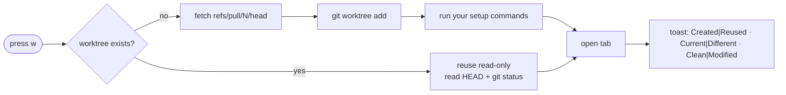

<div align="center">

# ⎇ Tern Plotroom

**Your GitHub PR queue, living inside [Tern](https://docs.stencil.so/tern).**
Triage with the keyboard. Check a PR out into its own worktree with one key. Point an agent at it with another.

[](https://github.com/andyhite/tern-plotroom/actions/workflows/check.yml)


</div>

---

```
 ┌─ Plotroom · GitHub PRs ──────────────────────────────────────────── ⚙ ↻ ─┐
 │ Filters          │  #482  fix: debounce search input         ✓ 3/3  In tab │
 │ ▸ Needs review   │  #479  feat: worktree setup commands       ● 1/4        │
 │   Mine           │  #471  chore: bump luau-lsp                ✓ 2/2  Wtree │
 │   Drafts         │  #468  docs: README, but fancy             ○ 0/1        │
 │                  │                                                         │
 │ Auto-refresh: every 60 s, next 14:02:11  ·  4,991 / 5,000 until 14:30     │
 └──────────────────────────────── ?  keys  ·  /  search  ·  w  worktree ─────┘
```

<sub>Illustrative, not a screenshot.</sub>

## Table of contents

- [60-second start](#60-second-start)
- [What you get](#what-you-get)
- [Keys](#keys)
- [How it behaves](#how-it-behaves) · Filters · Refresh · Accounts · Agents · Worktrees · SSH aliases
- [Trust and data](#trust-and-data)
- [Develop and verify](#develop-and-verify)

## 60-second start

You need **Tern 0.8.2**, **`gh`** signed in to github.com, and **`git` ≥ 2.31**. Then:

```sh
git clone git@github.com:andyhite/tern-plotroom.git
cd tern-plotroom
tern plugin link ./plugin        # live-reloads on every edit
tern plugin list                 # → plotroom … ready
```

Open any pane inside a checkout of a github.com repository, hit the palette, and run **`Plotroom: Open GitHub PRs`**. The block remembers that pane's directory as its launch directory.

> [!WARNING]
> Link `./plugin`, **never the repo root**. The root watches `.git`, whose metadata (the `fsmonitor` cookie, for one) changes about once a second and would reload the plugin every 1–2 s.

<details>
<summary><b>Prerequisites, precisely</b></summary>

| Tool | Tested with | Minimum |
| --- | --- | --- |
| Tern | 0.8.2 (44c7f76) | not established |
| `gh`, signed in to github.com | 2.98.0 | not established. Per-repo accounts call `gh auth token --hostname github.com --user <login>`. |
| `git` | 2.56.0 | 2.31 (`git rev-parse --path-format=absolute`, per the Git 2.31 release notes) |
| `ssh` | not pinned | only needed for SSH host aliases (`ssh -G`) |

`gh` and `git` are found on Tern's PATH, else on your login shell's PATH (see [Trust and data](#trust-and-data)).

The verification gate (`scripts/check.py`) needs Python 3.9+. It pins Luau 0.742, luau-lsp 1.70.1 and Tern 0.8.2 (44c7f76). Nothing above was verified against older or newer versions than listed.

</details>

<details>
<summary><b>Other install modes</b> (clean install, types, switching between them)</summary>

- `tern plugin types ./plugin` writes the ignored `plugin/tern.d.luau` (editor types only, not a typecheck).
- Clean install: `tern plugin install ./plugin --force` copies the package; a plain reload does not re-copy it, so re-run after edits. See the [CLI reference](https://docs.stencil.so/tern/reference/cli.md).
- `link` refuses while an installed copy exists, and `install --force` never replaces a link.
  - Installed copy → live dev: `tern plugin remove plotroom && tern plugin link ./plugin`
  - Live dev → clean install: `tern plugin unlink plotroom && tern plugin install ./plugin --force`

Tern watches the linked tree and reloads on any change ([lifecycle](https://docs.stencil.so/tern/concepts/lifecycle.md)).

</details>

## What you get

| | |
| --- | --- |
| 🔍 **Saved filters** | Any GitHub search query, scoped to the repo you launched from. Switch with `Tab` + arrows. |
| ⚡ **Live, polite refresh** | Polls every 60 s while quota is ample, backs off from GitHub's own rate-limit headers, pauses instead of hammering. |
| ✅ **Checks in the preview** | Full check list for the selected PR, re-runs collapsed to the newest. |
| 🌳 **One-key worktrees** | `w` checks the PR out into `<checkout>.plotroom/<owner>/<repo>/pr-N` on a branch that tracks `refs/pull/N/head`, and opens a tab there. Never resets, cleans, or deletes anything of yours. |
| 🤖 **One-key agents** | `a` picks an [omp](https://github.com/can1357/oh-my-pi) prompt template or skill and runs it on the PR, inside its worktree. |
| 👤 **Per-repo `gh` accounts** | Work and personal repos on one machine. Tokens live in memory for a single call, never on disk. |
| 🔐 **Fails closed** | Unusable account, unreadable store, rejected query: the block tells you and does nothing, rather than guessing. |

## Keys

Press **`?`** in the queue or Settings for the same list in the block. Settings and Refresh sit top-right in the queue header.

### Queue

| Key | Does |
| --- | --- |
| `↑` `↓` (or `k` `j`) | Move through PRs, or through filters when the filter list has focus |
| `Page Up` `Page Down` | Jump 10 PRs |
| `Home` `End` | First / last PR (or filter) |
| `Tab` | Switch focus between the filter list and the PR list |
| `Enter` | Open the selected PR in a Browser block docked beside the queue. With the filter list focused: move to the PR list. |
| `w` | Create or reuse the PR's worktree and open it in a new tab |
| `g` | Go to the tab working in the selected PR's worktree (only when the PR shows "In tab") |
| `a` | Pick an omp prompt template or skill and run it on the selected PR (see [Agents](#agents)) |
| `/` | Search the loaded PRs (title match; the picker marks hits) |
| `Esc` | In search: clear the text, then close the search. With the filter list focused: back to the PR list. |
| `r` | Refresh now |
| `s` | Settings |
| `?` | Show or hide the key list (`Esc`, `Enter` or `?` closes it) |

While searching, every other key edits the search text: `Ctrl`/`Alt`+`←` `→` move by word (add `Shift` to select), `Ctrl`/`Alt`+`Backspace`/`Delete` delete a word, plus select-all, copy, cut and undo. Pasted line breaks become spaces; malformed bytes and control characters are dropped.

Mouse works too: PR rows, preview buttons (Open, Worktree, Agent, Go to tab), the PR number in the preview (click to copy the link), and the header's Settings and Refresh. Palette commands `Open selected PR in Browser`, `Open selected PR in a worktree`, `Run an agent on the selected PR` and `Go to the selected PR's tab` act on the focused Plotroom block.

### Settings (`s`; three pages: Filters, GitHub, Worktrees)

| Key | Does |
| --- | --- |
| `↑` `↓` | Move between rows |
| `Enter` / `Space` | Edit a text row, or press a row's button. While editing, `Enter` is the only save (unchanged text just closes), and `?` is typed as text. |
| `Esc` | While editing: discard the edit, nothing is saved. A rejected value stays in the field with its warning until you fix or discard it. Otherwise close Settings. |
| `Tab` / `Shift+Tab` | Next / previous page |
| Delete filter confirmation | `Enter` or `Esc` keeps the filter; `d` (or a click on Delete) deletes it |

Rows with an override (account, checkout) show a Reset control that clears it.

## How it behaves

Everything below is the fine print. Skim the summaries; expand what you need.

### Filters

- **Filters** page: saved GitHub search queries (name, query, delete, new). Stored in the plugin's `kv.json`.
- Every filter runs inside the launch directory's repository: the repo is the first github.com remote of that checkout (origin, then upstream, then alphabetical), read with local `git`. SSH aliases also run `ssh -G` (see [SSH aliases](#ssh-aliases)). No repo means no search and a Retry card.
- `repo:`, `org:`, `user:` and a bare uppercase `OR` are rejected with a message, since they would widen the search; `OR` inside a matched pair of double quotes is plain text and allowed.
- **GitHub** page: the repository's `gh` account, "Refresh now", and the API quota card.
- **Worktrees** page: the local checkout path for this repository, used when the launch directory is not a checkout of it, and the repository's setup commands (see [Worktrees](#worktrees)).

### Refresh

- One search request returns up to 100 results; a refresh makes at most 10 requests (GitHub's 1,000-result cap).
- Runs on launch, on filter changes (a cached result younger than the refresh interval is shown instead), on `r`/Refresh/Retry, and by timer. Re-selecting the active filter does nothing. Refresh while one is running toasts "Already refreshing".
- Interval: 60 s while GitHub's `X-RateLimit-*` headers (read from the search responses themselves, never a separate `/rate_limit` call) show ample quota. Otherwise the time to reset is spread over 80% of the remaining requests, divided across open Plotroom panes (panes using the same account share its quota), never below 60 s.
- Remaining quota 0 pauses every trigger, manual ones included, until GitHub's reset. A `Retry-After` header (plain seconds or an HTTP date, at most 24 h) pauses until that deadline; a rate-limit error without headers pauses for 5 min. Malformed header values are ignored.
- The header shows `Auto-refresh: every …, next HH:MM:SS` or `Paused by GitHub rate limit until HH:MM:SS`, with the quota and its reset time.

<details>
<summary><b>Partial results, failures and pauses</b></summary>

- A search is complete only if every counted PR loaded and the scan was not cut. Otherwise the header says `Partial results: narrow this filter`. A cut is: quota exhausted mid-scan, an empty page that still has a cursor, a cursor that does not advance, or more than 10 pages (more than 1,000 results). The pages received are kept and flagged.
- If any page fails (network, auth, rate-limit error), that whole refresh is discarded. The last complete result stays on screen, marked `stale`, with the reason.
- **Paused states**: with no GitHub repo, or after a terminal error (`gh` missing, not signed in, not found, search rejected with HTTP 422, unusable account), auto-refresh stops and the header says so ("Auto-refresh paused…"). Nothing re-runs git or `gh` on its own, not on filter selection and not after a plugin reload (all pauses except the account one are saved with the block state). Only Retry, `r`, Refresh, or saving a different account tries again, once. A 422 belongs to one query: editing or switching the filter clears it.

</details>

<details>
<summary><b>Checks</b></summary>

The preview lists a PR's checks: the search returns the first few, the full list (up to 3 pages of 100) loads for the selected PR after a short pause. Re-runs of the same check suite and name collapse to the newest (a queued re-run counts as newest; `required` survives from any attempt). Same-named checks from different workflows, apps or commit statuses stay separate rows. A failed load is not cached: the preview shows the reason and either `Trying again at HH:MM:SS` (rate limit waits for the reset, other errors back off) or a Retry button (sign-in, access and missing-`gh` errors wait for it). Check loads also wait out a quota pause. A check's link may point to any https page its app set; the click is bound to the row shown.

</details>

### Accounts

- No saved login: the active `gh` account, as before. It is never switched globally.
- The GitHub page's `gh account` row sets a login for this repository (stored in `kv.json`; Reset clears it). Saving drops cached results and checks of the old account in every open block and refreshes once. An SSH key or alias selects only the git transport, not the API account: a repo under another account needs its login set here.
- Sign in and manage logins with `gh auth login` / `gh auth switch`; Plotroom has no login flow.

<details>
<summary><b>Fail-closed rules and token lookup</b></summary>

- **A saved login that cannot be used fails closed.** If the saved-accounts store cannot be read, or this repository's login is not letters, digits and hyphens, the block pauses with `GitHub account unavailable`. No search, checks, PR metadata or worktree `gh` call runs, and nothing falls back to the active account. Fix or clear the row, then Refresh.
- Saving fails closed too: an unreadable or malformed store is reported and nothing is written, so other repositories' logins are never overwritten.
- **Token lookup.** For a repository with a saved login, every `gh` call first runs `gh auth token --hostname github.com --user <login>` and hands the result to that one child as `GH_TOKEN`. The token lives only in memory for that call: never stored, logged, shown or put in argv. No answer within 30 s is a retryable failure; a non-zero exit or empty token is "not signed in" (terminal).

</details>

### Agents

`a` (or the Agent button) opens a picker of what omp can run on the selected PR:

- **Recent:** your last five picks.
- **Type a prompt…:** your own text, sent as it is.
- **Templates:** omp prompt templates, from the nearest `.omp/prompts` above the launch directory, then `~/.omp/agent/prompts`. A repository template hides your own of the same name, as in omp. The detail is the frontmatter `description`.
- **Skills and commands:** what `omp --mode rpc` lists as skills and file commands (Plotroom runs it in the launch directory, 10 s timeout). Built-ins and extension commands are left out. If omp cannot be run, the picker still opens without them.

A pick creates or reuses the PR's worktree (as `w` does), starts an agent there with your agent settings and sends `/<name> <PR URL>`; omp hands the URL to the template as `$ARGUMENTS`. If a tab already works in that worktree, the agent joins it; otherwise it opens in a new tab named `PR #N · <repo>`.

The worktree's branch (`plotroom/<owner>/<repo>/pr-N`) tracks `refs/pull/N/head` on the PR's remote, so `gh pr view`, `gh pr diff` and the like inside the worktree find the PR without arguments. `git pull` there fetches the PR's latest head.

**In tab.** A PR whose worktree holds some pane's directory on this host gets an "In tab" badge in the list and preview, plus a "Go to tab" button (`g`). Go to tab only finds tabs in the current window.

### Worktrees

`w` (or the Worktree button) checks the selected PR out in `<checkout>.plotroom/<owner>/<repo>/pr-N` (lowercase) on branch `plotroom/<owner>/<repo>/pr-N`, then opens a new tab named `PR #N · <repo>` there. The checkout is the launch directory's, else a path you map once under Settings › Worktrees (`~/` expands; otherwise absolute).



**Non-destructive policy.** Plotroom never runs `reset`, `clean`, force checkout, `stash`, `worktree remove`, `prune`, `branch -d/-D`, or `update-ref -d`. It never moves or deletes a branch: a branch that exists elsewhere than the PR head with no worktree is left untouched and the message offers ways forward. Only creating a new worktree writes anything (the fetched ref, the branch, the directory).

<details>
<summary><b>Created or reused: what the toast means</b></summary>

A new worktree is created at the PR head; normally that reads `Created · Current · Clean`. If one already exists for the PR, Plotroom reuses it read-only. In both cases it reads HEAD and `git status` afterwards (a checkout hook may write files into a new worktree), and never fetches into an existing worktree, updates, resets, cleans, merges or touches your commits or changes. The toast and a persistent card in the PR preview (kept per PR while the pane lives, not saved; the row also gets a `Worktree` badge) report:

`<Created|Reused> · <Current (PR head abc1234 on <branch>)|Different (local abc1234, PR head def5678 on <branch>; not updated)> · <Clean|Modified (uncommitted changes kept)|Changes unchecked>`

The toast is green only when the worktree is current and unmodified. `Changes unchecked` means `git status` failed or was slow. Reuse after the PR gets new commits says `Different … not updated`: updating an existing worktree is always your decision. Tern hides the whole preview in panes under 640 px wide, so only the badge remains there.

</details>

<details>
<summary><b>Refs and odd branch names</b></summary>

Fetching uses `refs/plotroom-pr/<owner>/<repo>/pr-N`. GitHub names Git refuses (`.github`, `a..b`, `x.lock`) are encoded one-to-one in the branch and ref only (`%2E` for the offending dot); every other name is unchanged and the directory keeps the raw name. Older `refs/plotroom/…` refs from earlier versions are harmless; delete them with `git update-ref -d`.

</details>

<details>
<summary><b>Setup commands</b></summary>

Settings › Worktrees › "Setup commands for <owner>/<repo>" holds commands for this repository, saved in `kv.json`. When Plotroom creates a worktree (not when it reuses one), they are typed into its new tab's shell as one line joined with `&&`, so they run in order and stop at the first failure; you see the output and can interrupt them. "Add a command" appends one; emptying a command removes it. A new worktree from `a` gets the same shell tab and the agent joins it, but the agent starts without waiting for setup to finish.

</details>

<details>
<summary><b>Updating and cleaning up (yours to run)</b></summary>

**Updating.** When a reused worktree is behind, the preview card offers, collapsed, with a Copy button:

```sh
git -C <path> fetch <remote> refs/pull/N/head
git -C <path> merge --ff-only FETCH_HEAD
```

`--ff-only` refuses rather than rewrite local commits.

**Safe cleanup.** The card's "Remove this worktree when you are done" section has these commands filled in. Inspect first:

1. `git -C <path> status --short` shows uncommitted and untracked files.
2. `git -C <root> log --oneline <ref>..<branch>` shows commits on the branch that are not the PR head (needs the fetched ref to exist).
3. `git -C <root> worktree remove <path>` refuses while there are uncommitted or untracked changes.
4. `git -C <root> branch -d <branch>` refuses while commits are unmerged.
5. `git -C <root> update-ref -d <ref>` drops only the ref Plotroom fetched.

Git leaves `<checkout>.plotroom/<owner>/<repo>/` behind empty; `rmdir` is safe. Use `--force` or `branch -D` only after you inspected the changes and commits above and decided they are disposable. The "branch is at a different commit" message mentions `branch -D` as the way to start over for that reason: it drops commits only that branch holds.

</details>

<details>
<summary><b>Errors you can act on</b></summary>

- Branch elsewhere than the PR head, no worktree: reopen it as it is with the `worktree add` command in the message, or inspect then start over.
- Target directory exists but is not this PR's worktree: move or remove it.
- Locked, prunable or missing worktree record: wait if another window is creating it, else `git worktree repair` or `prune` yourself.
- Cannot create the parent directory (read-only parent, a file in the way): fix it; the next click retries.
- Tab did not open: the worktree exists; click Worktree again (reuses it).
- Two windows racing: git's locks arbitrate; the loser is reported as `Reused`.

Browser blocks accumulate, one per open (and one per window showing the same session).

</details>

### SSH aliases

A remote such as `git@github.com-personal:owner/repo.git` or `ssh://git@alias:2222/owner/repo` counts as GitHub when `ssh -G [-p port] git@<alias>` (reads your ssh config, opens no connection) reports `hostname github.com`. Host-name guesses are never used; other hosts are rejected. The remote is not rewritten, so `git fetch` keeps using the alias and its key.

## Trust and data

Short version: **no secrets on disk, no shell in the loop, no PR code runs unless you configured setup commands.**

- **No secrets in the repo or in storage.** Tokens are memory-only (see [Accounts](#accounts)); the plugin does not log.
- **Plaintext storage.** The plugin's `kv.json` holds saved filters (names and queries), checkout paths, worktree setup commands, gh logins and your last five agent picks, readable by anyone with access to your Tern config. The block state saves the launch directory, active filter and pause state; fetched PR data is never saved.
- **External processes.** Plotroom runs `gh`, `git`, `ssh -G` and `omp --mode rpc` (to list skills) as argv arrays, never through a shell, and trusts whatever those names resolve to on PATH. If they are not on Tern's PATH it runs `$SHELL -l -i -c` once (5 s timeout, fixed script, result cached in memory, repeated after Retry or a Worktree click) to read your login shell's PATH; that executes your normal shell startup files.
- **PR code runs only through your setup commands.** `git worktree add` does not initialize submodules; repository hooks run only if your git config points `core.hooksPath` at them. The new tab's shell runs your rc files in that folder. Setup commands come from your settings, never from the PR, but they run in the PR's code: `pnpm install` or `make` executes whatever scripts the PR's author wrote. Leave them empty for repositories that take untrusted PRs.
- **Git network use.** Fetch and worktree commands run with git's own prompts disabled (`GIT_TERMINAL_PROMPT=0`) and a 120 s timeout, using your configured credentials.
- **Links.** `plotroom://` links are accepted only from Plotroom blocks and only if they equal a link on screen. PR URLs are rebuilt from validated owner/repo/number; check links may open any https page a check app provides (the click is bound to the displayed row). The agent link only opens the picker; what runs is what you pick or type.
- **Agents read PR text.** A template or skill that reads the PR (title, body, diff) hands text written by whoever opened it to your agent. Be careful running agents that can act on untrusted PRs.

## Develop and verify

```
plugin/             the package Tern loads (link this)
├── host.luau       the `prs` block: the live PR queue with saved, editable filters
├── window.luau     opening Plotroom, validated plotroom:// links, palette commands
├── github.luau     paged PR search snapshots and PR metadata through your `gh` auth
├── worktree.luau   repo resolution and PR worktrees; argv only, never a shell
├── input.luau      single-line text model for search and settings rows
├── process.luau    the one process runner gh and git share; login-shell PATH fallback
├── plotroom.css
└── tests/          check.luau · regression.luau · runtime.luau (smoke driver)
scripts/check.py    the one verification command
```

One local command, from the repo root:

```sh
python3 scripts/check.py
```

It runs four stages and exits non-zero if any fails:

| Stage | What | Run alone |
| --- | --- | --- |
| `test` | Standalone Luau (fake Tern SDK, virtual clock, fake process/KV/fs) over the real plugin modules: `plugin/tests/check.luau` and `plugin/tests/regression.luau` | `python3 scripts/check.py test` |
| `types` | `luau-lsp analyze` against the pinned SDK copy `scripts/tern-0.8.2.d.luau`; any diagnostic fails | `python3 scripts/check.py types` |
| `bench` | Renders the real queue view with 1,000 PRs; fails above `PLOTROOM_BENCH_BUDGET_MS` per render (default 250) | `python3 scripts/check.py bench` |
| `smoke` | An isolated headless Tern on temporary directories (never your live daemon or plugin registry): the self-test toast, no `plugin style sheet has errors` in Tern's log, and real-git worktree scenarios with a fake `gh` | `python3 scripts/check.py smoke` |

Tools come from `LUAU`, `LUAU_LSP`, `TERN` (paths), a cache under `~/.cache/plotroom-check/`, then PATH; `python3 scripts/check.py tools` downloads the pinned Luau and luau-lsp with SHA-256 verification (the only network use).

<details>
<summary><b>CI vs real Tern, self-test commands, and when a stage fails</b></summary>

**CI vs real Tern.** `.github/workflows/check.yml` runs `python3 scripts/check.py tools`, then `python3 scripts/check.py --ci`: test, types and bench only. Tern is not available there, so smoke is reported `NOT RUN` (the verdict reads "PASSED the portable subset; smoke NOT RUN"), never as passed. Only the local run exercises the real Tern runtime.

`tern plugin list` showing `ready` proves only that the plugin loaded; it cannot see CSS or type errors. The quick palette command `Plotroom: Self-test` (with `PLOTROOM_SELFTEST=1` in Tern's environment) runs only the pure helpers in `plugin/tests/check.luau`. With that variable the palette also has `Plotroom: Worktree smoke`, used by the gate on throwaway repositories only; do not run it in a window you use.

**If a stage fails.** The first failing assertion or diagnostic is printed with its file and line. Fix it and rerun that one stage. A missing tool is a failure with the exact path or variable to set, not a skip.

</details>

---

<div align="center">
<sub>Built for Tern 0.8.2 · <code>w</code> to check out · <code>a</code> to delegate · <code>?</code> when lost</sub>
</div>
