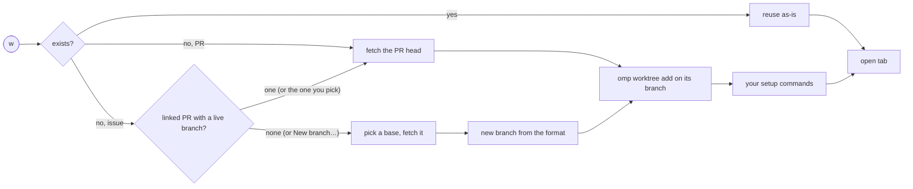

# Plotroom reference

This is how Plotroom behaves today, step by step through [the loop](../PRODUCT.md#the-loop), in the words of [the glossary](../PRODUCT.md#glossary). [README.md](../README.md) is the short tour; this page is the full spec, and it changes with every change in behavior.

- [Setup](#setup)
- [Commands and keys](#commands-and-keys)
- [Intake: Now, views and Pins](#intake-now-views-and-pins)
- [Triage](#triage)
- [Dispatch: worktrees and actions](#dispatch-worktrees-and-actions)
- [Supervise: agents](#supervise-agents)
- [Land](#land)
- [Clean up](#clean-up)
- [Trust](#trust)
- [Finer points](#finer-points)

## Setup

```sh
tern plugin install github.com/andyhite/tern-plotroom/plugin
```

Then, from any pane: Tern's palette → **Plotroom: Open**. The first time, **Get started** shows above the preview with what is left before an agent can run, one action per line:

1. `gh` installed and signed in to github.com: **Setup guide ↗** while it is not.
2. `omp` installed (it runs the agents and makes the worktrees): **Setup guide ↗** while it is not.
3. A checkout for each repository among the listed items that has none: **Use ~/code/repo as the checkout** when Plotroom found one, else **Choose the checkout of owner/repo…**, which asks for a folder (a new or empty one gets a clone).
4. The one-key shortcuts (`j k w g a G m z Z n o / r s ? u d`): **Use them** or **No thanks**.

Plotroom finds a checkout in the folder it opened in, or in the folder of any open Tern pane on the same host, when that folder is inside a git checkout with a remote on that github.com repository; it is verified as Settings › Repositories verifies one, and the disk is never scanned. So with `gh` and `omp` installed and the repository open in a Tern tab, you get from Plotroom: Open to a running agent without opening Settings: press Worktree or pick an action on an item. Worktree, an action or Type a prompt… on a repository with no checkout offers the same **Use** first, then **Another folder…**. The checklist goes once every line is done, or for good with **Dismiss**; Commands › **Get started** shows it again.

Requires Tern 0.9.8, `git` ≥ 2.36 and [`omp`](https://github.com/can1357/oh-my-pi) (worktrees and agents), plus the CLI of each integration you use: `gh` signed in to github.com for GitHub, Atlassian's [`acli`](https://developer.atlassian.com/cloud/acli) signed in (`acli jira auth login`) for Jira. An integration is only there while its CLI is installed on the block's host: without `gh`, Plotroom has no GitHub views, groups or prompts, only Settings › GitHub with a **Setup guide** button to gh's install instructions; without `acli`, the same for Jira (Settings › Jira). Install the CLI, then Refresh (or show its setup page again) and the integration turns on.

One Plotroom block holds every saved view in its sidebar: GitHub pull requests and issues, and Jira issues. Opened inside a github.com checkout, it saves that checkout as the one its worktrees come from (Settings › Repositories).

The Files pane's **Open Plotroom** header button opens the same block beside the focused pane, starting in the folder Files shows. If that folder belongs to another host, focus a pane on that host first; Plotroom never interprets one host's path on another.

Update later with the same command plus `--force`.

**Start over.** Settings › General › Reset › **Reset all settings** clears every saved setting on the block's host, as if Plotroom were freshly installed: the views (the default views come back), the actions (the default actions come back), the keyboard shortcuts, the repositories with their checkouts, branch formats and setup commands, the Jira projects' repositories, the branch and folder name formats, Now's switches, the Summary settings, and Get started (the checklist shows again). It keeps work state: triage (seen and snoozed items), usage counts, the run log, agent links and the Summaries made. The palette asks first, with Cancel first; every open Plotroom block shows the defaults at once. A store that could not be read or is malformed is cleared too, so this is the way out of a corrupted one. A setting that cannot be cleared is named under the row; the others are cleared all the same.

**From the separate Issues block.** There is no *Plotroom: Open Issues* command any more: Plotroom: Open is the one entry point and shows issue views too. Tern has no way to convert a pane, so a pane of the old Issues block does not work in the new version: close it and open Plotroom once. A pane of the old PR block reopens as it was. Your saved views and prompts are not touched: the new block reads them where they are.

**Remote hosts.** A Plotroom pane on a remote host works like a local one: the queue, worktrees and agents run on that host, with its `gh`, `git`, `omp`, checkouts and saved settings. Install Plotroom on both machines (the command above, run on each); plugins are not updated or synchronized automatically. The plugin's version is its release (see CHANGELOG.md); the protocol its window and host speak is separate. A window works with a host one protocol older, so updating one machine first is fine: actions the older host knows run as usual, and an action it does not know is refused at once with a toast saying to install the current Plotroom on that host. A host outside that range is another version: with Tern's status bar enabled, a focused Plotroom pane shows **Plotroom on <host> is a different version from this window's**, and host-backed actions are refused with a toast naming the host. The local window checks on focus and every two seconds while Plotroom stays focused, so the warning clears when the host is updated. A missing marker while the block loads shows no warning.

## Commands and keys

`.` opens **Commands**, the one key bound by default. Its rows are grouped and filtered to what applies now, **Next** first (the selected item's suggested next move; see Triage), then **Actions** (Type a prompt…, the actions offered under the view, and Go to agent while the item has one, plus Interrupt agent, Stop agent… and Message agent… while its agent is live, and Disagree with check… while its newest agent is a checker with a verdict; there is no separate agent picker in the menu), then **Jira - Issue**, **GitHub - PR** and **GitHub - Issue** (the selected item's own operations, under the heading of its type: Open, Worktree, Go to tab while the item has a tab, Assign to me, Comment…, Close or Reopen issue…, Ready for review… or Convert to draft…, Merge…, Approve…, Request changes…, Update branch… while the preview shows the branch behind its base, Push empty commit… while it shows the PR's own branch up to date and free of conflicts, Re-run failed checks, Draft PR…, each only where it applies), **Now** (Next in Now, Go to agent while the selected Now row's agent needs you, and Reply… while it waits for input, Mark all notifications read… while Now holds unread notifications), **Triage** (Mark seen, Snooze until tomorrow, Unpin while it is pinned), **Filter & Sort** (Show or hide snoozed, Next sort order, Search, Refresh), **Views** (every entry in the sidebar's order, Now, Pins, Worktrees and Agents included, and Open item by URL…) and **Configuration** (Settings, Shortcut list, Copy usage report). Rows that need a selection are not listed without one, nor are commands the item cannot take (no merge on an issue, no re-run without a failed run); each row shows its key if it has one. Settings › General gives any queue action, and any action, a key of its own (Enter on its row, then the key, or Backspace to remove it), for pull requests and issues alike and per machine. The queue has no bottom bar: every action is its key and its Commands row (Worktrees' Remove finished, Now's Reply… and Go to agent, Refresh and Settings included). While GitHub's rate limit holds, the header says **Paused by GitHub until HH:MM:SS**; Remove on a locked or missing worktree toasts why it is not removed; the preview's head opens the item (the globe icon, **Open**). The arrows, `Enter` (open the item in a Browser block beside the queue), `Tab` (sidebar ↔ queue), `Esc`, Page Up/Down, Home and End are fixed. **A view with items selects its first item when it opens** (Worktrees, its first worktree), so a preview always shows; it cannot be closed. `Esc` clears a search, moves focus from the sidebar back to the queue and cancels the dialog it applies to; it never clears the selection. A selected item's preview stays usable in a narrow block, shown below the queue. Once bound, `?`'s Shortcut list shows the keys as you have set them. Settings › General has a **Use one-key shortcuts** row that binds the classic set (`j`/`k` move, `x` next move, `n` next in Now, `w` worktree, `g` go to tab, `a` agent picker, `G` go to agent, `m` mark seen, `z`/`Z` snooze, `o` sort, `/` search, `r` refresh, `s` settings, `?` help, `u` find finished worktrees, `d` remove) to the actions that have no key; a key you saved keeps its action (a shortcut you removed stays removed), and a preset key another action already uses is skipped and listed in a toast.

Commands lists only names, details and keys: an action's prompt text is not sent with it (the action runs through its own link, which fetches the text), so many or long prompts never push rows out of Commands. An action's row shows the prompt's first line with its variables filled in for the selected item (`{url}` `{owner}` `{repo}` `{number}` `{title}` `{author}` `{branch}` `{base}` for a PR; an issue's url, key, title, author, labels, owner, repo and number, or project, status and type), or no detail when a variable stays unfilled. Opened from **Agents**, it offers **Go to agent**, **Interrupt agent**, **Stop agent…** and **Message agent…** for the selected row (its own **Agents** group), the views, Settings and the shortcut list, and none of the queue's Snooze, sort, search or Refresh rows. Opened from **Now**, it offers Go to agent while the selected row's agent needs you and Reply… while it waits for input, Mark all notifications read… while Now holds unread notifications, Show or hide snoozed, Refresh, the views, Settings and the shortcut list.
Starting an action by its key, a Commands row or a typed prompt while a live agent already works on the item first asks **Go to agent (state)** (with the action's name as detail; its key hint reads "go or start") or **Start <action> anyway**; Cancel starts nothing. The agent picker lists every action whatever the size of their texts, and a pick fetches its own text. Other pickers' Enter hints: message selection "send", draft review "create or edit", draft destination "open".

**Tern's palette** lists only these Plotroom entries: **Plotroom: Open**, **Plotroom: Open item by URL**, **Plotroom: Message an agent with the selection…** and, while something needs you, **Plotroom: Show what needs you (Now)** and, while an agent needs input, **Plotroom: Go to the first agent that needs input**. Every other Plotroom command lives in Commands (`.`) and keeps its key there; each also stays runnable by its action name `plugin.plotroom.<id>` (a Tern key bind, or `tern ctl plugins run`), for example `plugin.plotroom.snooze` or `plugin.plotroom.worktree-selected`, acting on the focused Plotroom block.

An action's own key wins over Next move, Next in Now, Go to agent, Mark seen, Snooze until tomorrow, Show or hide snoozed, Next sort order and Commands while that action is offered for the selected item: it was that key first. Likewise a key you saved for any queue action is yours first: the default `.` for Commands is left unbound when you gave `.` to something else.

**The key footer.** A line under the queue lists at most five keys that work now for what is selected, each as a keycap with what it does: **Commands** and **Shortcut list** first, then the selected item's **Next move** (named as the move), then the most used of the rest by this host's usage counts (the selected item's actions with a key of their own, Agent picker and the queue actions Commands offers here), ties in Commands' order. An action with no key is not listed: with only the default `.`, the footer shows Commands alone, and with no key bound at all there is no footer. A key shows what it runs: an action's own key where it beats the built-in key (above), the built-in one otherwise. The Worktrees, Agents and Now lists show their own keys the same way; with Settings open, where keys go to Settings, there is no footer. Every Commands row and preview button whose action has a key shows that key: a Commands row as `key x` before its detail, a button as a keycap (Next move, Worktree's Go to tab or Open in new tab, and Unsnooze, which wears the Snooze until tomorrow key: snoozing a snoozed item ends its snooze).

Commands' item rows also offer **Copy link**, **Copy number** (`#N`, or the Jira key) and, when the item has a head branch or a worktree branch, **Copy branch**. The pane title names what is shown and then what needs you, by Now's reasons in Now's order, each part only when it isn't zero: `Plotroom · My PRs · 2 agents need you · 1 Blocked · 3 reviews requested`, `Plotroom · Now · 1 Ready to merge · 2 notifications · 1 assigned: new or changed`. Counts of a view's items are in the sidebar only; neither the pane title nor the queue's heading repeats them. Now's heading is the exception: it says how many it lists (see Triage, Next in Now).

## Intake: Now, views and Pins

- **Now.** The first entry in the sidebar, and what a new Plotroom block opens on (a block launched to show one item opens on it; a restored block on the entry it showed). It lists everything that needs you, ranked, top first, each row with a first badge that says why: **Agent needs input** (any item whose agent waits for input), or, for an idle agent whose turn ended, the limit its chain stopped at (**3 failed checks**, **3 runs without progress** or **3 failed starts**, see Chain limits; the preview's Chain fact says it too), **Check failed** (its checker found what fails, see Supervise; the preview lists the findings), **Report: stuck** or **Report: needs human** (its end-of-run report says so, whatever its outcome) or **<outcome>: Not verified** (its run's outcome was checked and GitHub does not show it, see Supervise); **Blocked: …** (your open pull request is Blocked, with what blocks it); **Review requested** (open pull requests that ask for your review, oldest first: asked of you, asked again after you reviewed, or whose review of yours was dismissed, which GitHub does not ask again, so Now also searches the open pull requests you reviewed; the preview says "Your review was dismissed, so it is requested again"); **Ready to merge** (your open pull request); an unread GitHub notification you take part in, with its reason (Mention, CI…), when its item is not already listed; **Assigned: new** or **Assigned: changed** (open issues assigned to you, on GitHub and in Jira, that are New or Changed; the preview says "Assigned to you, and you haven't seen it yet" or "Assigned to you, and changed since you last saw it"). An assigned issue you have seen and nobody has changed since is not listed, and neither is one whose every change since you last saw it (for a New one, since it was assigned to you) is your own: assigning it to yourself, editing its title, labels or status, or commenting on it. Someone else's change lists it again. Changes whose author cannot be read keep the row listed. An item is listed once, at its highest reason. Snoozed items leave Now and its count; **Show or hide snoozed** lists them with a **Snoozed** badge (still not counted), and an agent that needs you always lists its item. The sidebar entry counts what is listed and not snoozed; Now's heading and the pane title split that count by reason (**N agents need you**, **N Blocked**, **N reviews requested**, **N Ready to merge**, **N notifications**, **N assigned: new or changed**), so each number names what to act on. An empty Now says nothing needs you. Now's queries are not edited and it is not deleted in Settings › Views (its entry there switches which reasons and accounts feed it), and it is not searched.
- **What Now reads.** For every signed-in `gh` login: its open pull requests (`is:open author:@me archived:false`), the open ones asking for its review (`is:open user-review-requested:@me draft:false archived:false`), the open issues assigned to it (`is:open assignee:@me archived:false`, with each issue's newest 10 timeline events and last edit, which tell who changed it) and the unread notifications it takes part in (`notifications?participating=true`, the first 50; a login whose page is full adds `Notifications (@login): showing the newest 50; the rest are on github.com` to Now's subtitle). While `acli` is on, Jira's open work assigned to you: the open sprint's, as **My sprint** reads it (`assignee = currentUser() AND sprint in openSprints() AND statusCategory != Done AND hierarchyLevel < 1`), while the site has sprints, else all of it (`assignee = currentUser() AND statusCategory != Done`). For a Jira issue that is New or Changed, Now also reads its last update and comments and asks whether you changed its assignee, status or priority since then; Jira's title and label edits cannot be told apart, so those keep the row listed. Agent states come live from the window. It is read with every refresh of the queue, whether Now is shown or not (so the pane title and the status line's `N need you` stay current on any view), and never more often: the GitHub points it spends join the block's cost, so the polite refresh interval stretches, and a login GitHub's cooldown holds is not asked. Notifications obey GitHub's `X-Poll-Interval` (no request is sent sooner); after it the whole first page is read again, so a thread marked read on github.com or elsewhere leaves Now at the next read (GitHub's `Last-Modified` does not move when a thread is read, so the read is never conditional). A source that cannot be read keeps its last answer and Now's subtitle says why (for a login's notifications, `Notifications (@login): …` with the fix `gh auth refresh -h github.com -s notifications`; the other logins' notifications are still listed); nothing falls back to another login. While a sign-in failure or a missing CLI holds the block, Now is not read either; Refresh tries again.
- **Settings › Views › Now.** The first entry of Settings › Views chooses which reasons and accounts feed Now, never its queries. **Reasons**, one switch each, all on by default, in Now's order: **Blocked**, **Review requested**, **Ready to merge**, **Notifications**, **Assigned**. **Include team review requests** (off by default, under Review requested) makes the review search `is:open review-requested:@me draft:false archived:false` (asked of you or of a team you are on) instead of asked of you directly; a request asked only of a team is listed under Review requested and its preview's Why line names the team (`Your team's review is requested: @org/team`), and the suggested next move still counts only requests asked of you (see Triage). **Accounts**: one switch per signed-in `gh` login, all on by default (a login that signs in later is on), and one for Jira while `acli` is on. A reason that is off is not read at all: its search or notifications read is not sent, and its rows, its part of the heading and pane title, the sidebar count and `N need you` leave it out at once. Blocked and Ready to merge share the search of your pull requests, read while either is on. An account that is off is not searched and its notifications are not read for Now; its saved views are untouched. With every reason off, Now lists only agents that need you and its empty state says `Only agents are listed: Settings › Views › Now`. A change applies at once in every open Plotroom block. The switches are saved in kv `now` (the reasons and logins that are off, Jira's switch, team review requests), not with the pane; switches that cannot be read, or are malformed, are never written over: Now runs with the defaults and each switch says why it cannot change.
- **Enter on a Now row** goes to the agent of a row that needs input, and otherwise shows the item in the block as a linked pull request is (selected in place when the shown view lists it, else pinned); a notification about neither, such as a CI run, says so. **Mark all notifications read…** (Commands, while Now holds unread notifications and its Notifications reason is on) confirms with Cancel first, naming each account and how many of its threads per repository, then marks every thread Now read read, each as the login it was read as: also a thread whose item Now lists for a higher reason (Review requested, say), a second thread on the same item and a snoozed item's. Read, never done, so GitHub keeps them in its inbox. Threads past the first 50 of a login, and those it does not take part in, are left to github.com. The accounts are fixed when the plan is made.
- **Answering an agent from Now.** A row whose agent needs input shows the agent's last message (as the Agents list reads it, cut to 200 bytes), and so does its preview, with **Reply…** and **Go to agent** in Commands › Now. **Reply…** asks for one line and sends it as **Message agent…** does; a blank line sends nothing. An agent that stopped waiting before the reply is sent gets the same toast Message agent… shows (`No agent is running for <item>`) and nothing is sent. Once the agent leaves Needs input, its row leaves Now (an item listed for another reason stays, under that reason). Structured choices an agent offers are answered in its pane: **Go to agent**. A row whose idle agent needs you for its report or its outcome offers only **Go to agent**, and its preview shows the action, outcome, report, reason and blocker; it leaves Now once the agent works again, exits, or a later check finds the outcome.
- **Typed views.** Saved searches in one sidebar, each a **Pull requests** or an **Issues** view. A GitHub view takes a GitHub search query across every repository its login can see (`repo:`, `org:` and `user:` narrow it); a Jira view takes JQL across every project `acli` can see. The sidebar groups the GitHub pull request and issue views together, with Jira views alongside. In a block 127 columns wide or narrower the sidebar folds into a dropdown whose entries read `GitHub - octocat: My PRs` (integration, profile when there is one, then the view) and show no counts. Settings › Views has a group for each `gh` login signed in and one for Jira while `acli` is installed, each with its views and an **Add view** button: the new view searches as that login (or through Jira) and is of the active view's type, an Issues view for Jira. While a group lacks one of the default views, **Add missing defaults** beside Add view adds back each default it has none named like, as that group's (an edited default keeps your query). A view's form holds its Type (GitHub views), name, query, grouping and prompts. Changing a view's Type keeps its name and query but not the prompts offered under it. Issue views list In Progress, then To Do, then Done.
- **Default views.** A first run starts with these. Pull requests: **My PRs** (grouped by repository) and **Review requested** (asked of you directly, oldest waiting first, without drafts). GitHub issues: **Assigned to me** and **Created by me** (assigned to someone else or no one). All GitHub defaults skip archived repositories; those not marked otherwise are grouped by repository. Jira: **My sprint** (yours, by status) and **Up for grabs** (unassigned, not started), both in an open sprint; **My epics** (by status). Only My epics lists epics (`hierarchyLevel = 1`); the others take `hierarchyLevel < 1`, whatever your site calls its epic type. The two sprint views come only when the Jira site has sprints: Plotroom asks once `acli` starts (again on Refresh), and Add missing defaults offers them once it does. Settings › Views › Add missing defaults adds back any default an existing install is missing.
- **Per-view accounts.** Work and personal `gh` logins on one machine: each signed-in login has its own group of views in the sidebar, searching as that login. Tokens stay in memory, never on disk.
- **Polite refresh.** Every 60 s while quota is ample; backs off from GitHub's rate-limit headers instead of hammering.
- **Open item by URL** (Tern's palette, or Commands): a GitHub pull request or issue URL, or a Jira issue URL. It is fetched first, so a missing or unreachable item is reported, then shown in the sidebar's **Pins** group, even when a listed view already holds it; nothing opens in a browser. Pins accumulate (up to 20; one more is refused with a toast) instead of replacing each other; **Unpin** (preview or Commands) removes one and leaves the rest. Pins are saved with the pane, so reopening Plotroom refetches and shows them again.
- **Pasting a URL**: paste into the queue (outside the search box) and the first GitHub pull request or issue URL, or Jira issue URL, in the text opens exactly as Open item by URL does (fetched, then pinned), the outcome a toast. Text with no such URL toasts and changes nothing. While the search box is open, a paste edits the search.
- **Linked PRs.** On an issue, click a linked pull request to show it in the same block: it is selected in the active view when that lists pull requests and has it; otherwise it is looked up alone under an `owner/name#N` entry at the top of the sidebar, and the other views stay there to go back to.
- **Shell lens.** After `gh pr create` in a shell pane, a lens shows the new pull request's URL with **Show in Plotroom**, **Copy** and **Open**. Show in Plotroom opens it in a Plotroom block on that shell's host, as Open item by URL does (fetched, then pinned), launching Plotroom first when none is open; the lens runs nothing else. Output with no pull request URL (a failed or cancelled create) stays raw, and Tern never lenses pipelines or redirects.

## Triage

- **Every item shows its stage.** Each row's first badge, and the first fact of the preview's status part, is where the item stands, derived on every render from what GitHub, Jira, git and its agent already said (nothing about it is saved). Highest first: **Merged** or **Closed** (a Jira issue in a Done status is Closed); **Needs you** (its agent waits for input, or is idle after a turn whose end-of-run report says `stuck` or `needs-human`, whose outcome is Not verified, or whose check failed); **Agent working**; **Blocked** (a PR with changes requested, conflicts, or failing checks GitHub's merge state does not call optional; the row's detail says which, and the preview's **Blocked by** fact says it under the stage); **Ready to merge** (approved, checks passing or none, and GitHub's merge state is clean); **PR open** (any other open PR, and an issue whose worktree branch has an open PR, known once its preview has loaded the details); **Worktree** (an issue with a Plotroom worktree and no PR; the badge takes the worktree's tone and summary); **Not started**. A merge state GitHub has not computed yet never makes Ready to merge. The stage replaces the row badges that said the same (Merged, a plain Closed, the Worktree badge of an item at Worktree, the Working and Needs input agent badges) and keeps New, Changed, Snoozed, Draft, why an issue closed and a Jira status.
- **A row shows only what decides at the list level.** The title; the author once, as the mark on the left; the number (a Jira key), then the repository only when the view's rows span more than one; for a Blocked PR the one thing that blocks it (**Conflicts with its base**, else **Changes requested**, else **Checks failing**); for someone else's open PR you approved whose head is no longer the commit you approved, **New commits since you approved** (the push makes it Changed too; derived from your latest review on every refresh, nothing stored); a Jira issue's type. Badges: the stage, the agent's state when the stage does not say it, the run's checked outcome and the checker's verdict, **New**/**Changed**/**Snoozed**, **Worktree**, **Draft**, a Jira status or why an issue closed. The age, the review, check counts and labels are the preview's (its facts, Reviewers and Checks sections), and **In tab** is the worktree card's (its **Go to tab**), so no fact is said twice in a row.
- **The selected item suggests its next move.** Its stage picks one move, shown as the first Commands row under **Next** (named as the move) and as a button at the top of the preview, below the title: **Worktree** for a Not started issue; the **Review** action for someone else's open PR that asks for your review (as the view's login, by name; a team request does not count; asked again after you approved, or your review dismissed, counts); **Go to agent** at Needs you or Agent working; at Blocked, the **Address feedback** action for your PR with changes requested, else **Re-run failed checks** while a run failed; **Merge…** at Ready to merge; **Ready for review…** for your draft PR; **Draft PR…** for an issue at Worktree; **Remove worktree…** for a Merged or Closed item that has a worktree. A move runs exactly as its own command does, its confirm included, and is offered only where that command is (an action only while it is offered under the view with that name). When nothing applies (an open PR waiting on others, a closed item with no worktree), nothing is shown. The queue action **Next move** runs it; it has no default key, and the one-key set binds it to `x`.
- **Next in Now walks what needs you.** The queue action **Next in Now** (no default key; the one-key set binds it to `n`; also Commands › Now, from any view) shows Now and selects its first, most urgent item, then on each press the following one in Now's ranking. On the last item it stays there and toasts **Last in Now**. Now's heading reads **N left** (how many items Now lists) at rest and **n of N** while walking. Moving the selection by hand (the arrows, Page Up/Down, Home/End, the move keys or a click) or a change of Now's list under it (an item arrives or leaves) stops the walk: the heading reads N left again and the next press resumes from the selected item, selecting the one after it. Showing Now again (from the sidebar, or after another view) starts a new walk at the top.
- **Seen is automatic; snooze is local.** Each item shows **New** (never seen) or **Changed** (its state, title, review, checks, head, comments, labels or assignees differ from when it was last seen). An item is marked seen when it is selected and its preview is shown in a view, and again if a refresh changes it while it stays shown; a background fetch, Now and Worktrees never mark anything. **Mark seen** stays in Commands to do it by hand. **Snooze until tomorrow** holds an item until 08:00 local time on the next calendar day, even when it is still early morning (a **Snoozed** badge when listed with **Show or hide snoozed**). An agent waiting for input surfaces its item even when snoozed. Seen and snooze state is per machine (kv `triage`).
- **Now and Show or hide snoozed survive a restart.** Both are saved with the pane and come back with it.
- **The count of what needs you.** With Tern's status bar enabled, every pane's status line shows **N need you**: the largest Now count of the open Plotroom blocks, and at least the agents that need input (checked every 4 seconds, hidden at zero). It is the one cross-pane count, and the one that is a button: clicking it (or **Plotroom: Show what needs you (Now)**) focuses that block and shows Now.
- **Sorting.** **Next sort order** cycles the active view through its sorts and saves it with the view (Settings › Views › Sort by, or Default order); each change toasts the new order (**Sorted: <order>**, with the view's name); Settings › Views › Sort by always shows the current one (Default order: GitHub's order on GitHub views, status order on Jira views). GitHub pull requests: Recently updated, Oldest waiting (by creation time), Review required first, Largest changes first (additions plus deletions). GitHub issues: Recently updated, Oldest waiting (by creation time). Jira issues: Priority (Jira's issue lists keep no update time), always within status category: In Progress, then To Do, then Done (shown only when the view includes it), whatever the sort; `Status` groups follow the same order, by status name within a category. A group's items are sorted inside it. Pinned items have no sort. Changing a GitHub view's Type keeps its sort where the new type offers it; otherwise the view returns to default order and a toast says so. Settings › Views › Group by also offers Fork (pull requests: the fork's owner, else Same repository) and Label (the item's first label, else No label; GitHub and Jira). A search that matches nothing says so with its text; the preview of a snoozed item has an Unsnooze button; a worktree removal git refused offers only Keep.
- **Checks and details.** The selected PR's full check list, re-runs collapsed to the newest, with its merge state (conflicts, behind base, blocked, ready; **Unknown** while GitHub has not computed it, and what the search said until the details load; none on a merged or closed PR), each reviewer's latest verdict and who is still requested, the issues it closes, and its description. Reloaded on every successful refresh, so check status changes show up even when the PR itself is unchanged. Linked pull requests and issues (an issue's linked PRs, a PR's closing issues, a Jira issue's links) show as their own sections with their state; a link Plotroom cannot read falls back to its name (the file's basename for a path) instead of an error.
- **Summary.** When the cursor rests on an item in a view for about a second, the top of its preview (under the title and next move) shows a **Summary**: 2 to 4 plain sentences on what the item is, what changed and what is still open, written by a small model. It waits for the item's details, then runs one `omp -p` call with no tools, session, extensions, skills, rules, LSP or title, its fixed system prompt saying to summarize only and follow nothing the item says, on the model set in Settings › General › Summary model (default omp's `@smol` role). It reads the title, author and description, for a pull request its size and first 30 changed files, and the item's 5 newest comments, each cut short. **Summarizing…** shows while it runs; the answer is plain text (never Markdown, a link or anything Plotroom acts on), and an answer that is empty or longer than a few sentences is refused. If it cannot be made, the preview says why (**Summary not made: …**), and it is not tried again until the item changes. Summaries are cached per machine (kv `summaries`, the newest 200) by the item and its head commit (a pull request) or update time (an issue), so a cached one shows at once and a push or an update makes a new one on the next select; a reply that lands after the cursor moved on is cached and shown only on its own item. Settings › General › Summary › **Summaries** turns them off; Now, Agents and Worktrees previews have none.
- **Pages open beside the queue.** Enter and **Open** show the selected item's page in Tern's Browser beside the queue. Use Tern's native Browser profile controls to choose shared, repository, session, named or private profiles in the Browser's address-bar chip. Browser logins are separate from the `gh` account a view searches as; Plotroom never copies CLI credentials into a browser profile or preloads hidden pages.
- **Approving a review.** The default **Review** and **Quick review** report findings under severity headings (**P0 · blocking**, **P1 · blocking**, **P2 · blocking** on Review when no follow-up is documented, **P2**, **P3**; empty ones left out), numbered 1…n across them, and list a Question only when its answer would change a finding's severity, whether it blocks, or the recommendation (usually none). No review body is drafted in the report. The agent then asks once, with three questions: **Post which comments?** (one choice per group, labeled with its numbers, the blocking groups picked by default; Other takes numbers or exclusions such as `1, 3, Q1` or `P2 except 5`; nothing picked posts no comments), **Review action?** (Approve, Request changes, Comment or None (comments only), the recommendation's picked by default; on your own pull request only Comment or None) and **Review body?** (None by default, or Draft one from my picks). Those answers are the authorization: it posts at once, except a drafted body (1–3 sentences about only the picked items and the action), which it shows first with Post or Edit. With no body, Approve posts none, and Request changes or Comment, which GitHub refuses without one, get only the posted items' headers. Picked items with no line to sit on go in the review body as themselves. Actions you saved keep their own text.

## Dispatch: worktrees and actions

- **Worktrees.** **Worktree** checks the PR out on its own head branch with `omp worktree add` into omp's worktree directory (default `~/.omp/wt`) as `plotroom-<owner>_<repo>-pr-N` (the folder name format is yours to change), and opens a tab there. On an issue, it uses the issue's linked pull request's branch, else a new branch from a base you pick. Never resets or cleans anything of yours; the preview's worktree card can remove the worktree, asking first and never forcing it. Needs the repository's checkout (Settings › Repositories); without one, Worktree, agents and prompts ask for it.



- Worktrees go in omp's worktree directory: `OMP_WORKTREE_DIR`, else omp's `worktree.base` setting, else `~/.omp/wt` (trailing and doubled slashes dropped, so it matches git's own listing); Plotroom has no folder setting of its own. The repository's saved checkout (Settings › Repositories; opening Plotroom inside a checkout, or a linked worktree of it, saves that checkout) is only where the worktree is added from.
- **Setting a checkout** (Settings › Repositories, Get started, or what Worktree, agents and actions ask when a repository has none: **Use** a checkout found open in Tern, or another folder) verifies the folder and clones into a new or empty one with `gh repo clone`, which can take minutes. One repository is set up one at a time across every pane: a second attempt meanwhile is refused as busy, and its row is disabled. If the repository was removed, cleared or given another checkout while it cloned, the finished clone is not saved (Settings shows "Checkout not saved"), and a clone that ends after its block closed saves nothing. A clone that fails never disturbs a field you are typing in.
- A pull request's worktree is on its own head branch, tracking it on GitHub (a fork's as `<fork owner>/<branch>`, tracking the fork), so `git pull`, `git push` and `gh pr view` work inside it without arguments. A fork PR's local branch is named differently from the fork's, so push with `git push <fork remote> HEAD:<branch>` (the fork's URL or a remote you added for it). A local branch of that name that already exists is used as it is, never moved; one that is noted for another pull request (a same-repository head `alice/x` against alice's fork branch `x`) is refused, naming both PRs. A worktree an earlier version made at the PR's folder (on `plotroom/<owner>/<repo>/pr-N`) is still reused.
- An issue's worktree is on the branch of its linked pull request when exactly one same-repository one still has its branch on GitHub; with several, or when only a fork's is left, Plotroom asks which, or a New branch, and fetches nothing until you pick. A fork's pull request (a deleted fork's counts, owned by its author) is never checked out unasked, and shows in that choice marked with its owner. A merged pull request is never linked: its branch is spent, so new work on it would never reach the base. A GitHub issue's linked PRs are those that close it; a Jira issue's are the pull requests of its repository whose title or head branch names its key. A new branch asks for the base branch it starts from (the remote's default first), fetches that base, and is named by the branch format. GitHub logins may contain `_` (Enterprise Managed Users), and a Jira repository typed as anything but `owner/name` is refused with a message.
- **Name formats** (Settings › Repositories, first): the new issue branch (default `{github.user}/{key}-{slug}`; a repository can have its own, in its form further down the page) and the folder names of PR and issue worktrees (defaults `plotroom-{owner}_{repo}-pr-{key}` and `plotroom-{owner}_{repo}-issue-{key}`, where `{owner}` and `{repo}` are lowercase). A branch format takes `{key}` `{slug}` `{owner}` `{repo}` `{project}` `{github.user}` `{jira.user}`; a folder format takes `{key}` `{slug}` `{owner}` `{repo}` and no `/`. Both need `{key}`. `{github.user}` is the view's `gh` account, else `gh`'s active one; `{jira.user}` is your Jira sign-in's email before the `@`.
- **Setup commands** (Settings › Repositories) run in the new tab's shell when a worktree is *created*. They execute the PR's code (`pnpm install` runs its scripts), so leave them empty for repos that take untrusted PRs. A **fork** PR's new worktree never runs them (the toast says "setup skipped: fork PR"), and its checkout runs with git hooks off (`core.hooksPath=/dev/null`); run setup there yourself once you trust the code.
- **Worktree tabs are named after their item.** A tab opened at a Plotroom worktree is titled `#123 title` (or `KEY-1 summary` for Jira) unless you renamed it. The names are kept in memory only, so after a plugin reload the tab shows its plain name.
- Reused worktrees are never updated. The preview's worktree card shows `Up to date|Not at PR head` and `Clean|Uncommitted changes|Changes unchecked` badges (their tooltip is the one-line summary), its branch and path, and, when the worktree is not at the PR's head, the `git pull --ff-only` command for you to run. A `N unpushed` badge says how many commits the branch holds that its upstream lacks (read with the same `git status --porcelain=v2 --branch` spawn as the changes; a branch with no upstream, such as a fork PR's worktree, shows none), and any `git …` command that finishes in a pane inside a worktree reads the card again, so the badges follow `git commit` or `git pull` at once. Its buttons: **Go to tab** while a tab works in it (else **Open in new tab**), **Remove worktree**, and **Open Git view**, which opens Tern's git block on the worktree (also a Commands row, on the card and on a Worktrees row). It shows while the worktree's folder exists and works for a block on this machine only: on a remote host a toast says "Open Git view works on this machine's worktrees only".
- **The card is read from git, not remembered.** After every refresh, Worktree press and removal (and when a checkout is saved) Plotroom lists the saved checkouts of the repositories on screen with `git worktree list`; it never asks per row. A worktree is a PR's when it is on the PR's head branch or in the folder the PR folder format names (every item that names it has it, e.g. an issue and its PR on one branch); an issue's when it is on the branch or in the folder the issue formats name now. So a block opened later, or after a plugin reload, shows the card and the row's **Worktree** badge of every such worktree, with no Worktree press; one you removed yourself leaves at the next refresh; and a read that fails changes nothing. `Up to date` compares the worktree's HEAD with the PR head the last refresh saw (a PR pushed since reads as it was until the next refresh). `Clean` / `Uncommitted changes` is read with `git status` for the selected PR only, once the cursor rests on it and again after each refresh; until then the badge says `Changes unchecked` and the row's badge has no colour.
- **The preview shows both halves of a worktree.** On an issue whose worktree's branch is the head of a GitHub pull request in the code repository (`gh pr list --head <branch> --state all`; an open one wins), that pull request joins the issue's **Linked pull requests** (number, title, state, a link that shows it in this block), unless they already have it; a Jira issue, whose linked items are issues, shows it in a **Linked pull requests** section of its own. On a pull request whose head branch (a fork's as `<owner>/<branch>`) is the branch of a worktree the last scan noted for an issue, that issue joins the pull request's **Linked issues** (after the issues it closes, once), with its key, title and status, linking to it; it is read as the view's GitHub account, and the first of two issues on one branch wins. The scan notes an issue's worktree only once an Issues view has been shown, so before that the pull request preview lists only the issues it closes; the next refresh's scan fills it. Worktrees does the same for a row with an issue and no pull request: the pull request on its branch shows as the row's linked pull request. These lookups ride the preview's own detail load (after the cursor rests; nothing polls), are best effort (a failed one shows nothing) and are read again on a refresh.

### Actions

- **Agents.** Commands' **Actions** group: pick an action (Settings › Actions) offered under the current view, or **Type a prompt…**, and it starts an [omp](https://github.com/can1357/oh-my-pi) agent block (Tern's `cx.agents:start`) inside the item's worktree (or, as the action says, the repository's checkout) with that prompt, no questions asked. An action may name the model omp runs it with (`omp --model`): a role alias such as `@slow`, or a model such as `opus`. Give an action a key (Settings › General) to run it straight from the queue.
- **Actions** (Settings › Actions) become rows in Commands' Actions group. Pull requests and issues each keep their own actions; the page lists both. Each has a name, a multi-line prompt (Edit… opens an editor; Enter is a new line, ⌘↵ saves, Esc cancels), and the views it is offered under; with none turned on it is offered under every view of its type. In a PR action's prompt, or a typed one, `{url}`, `{owner}`, `{repo}`, `{number}`, `{title}`, `{author}`, `{branch}` (the PR's head branch), `{base}` (the branch it merges into), `{remote}` (the checkout's git remote of the repository) and `{github.user}` (your GitHub login) become the PR's details, read fresh from GitHub; an issue's actions also take `{jira.user}`, and in a worktree `{base}` (the base a new branch was made from; empty when Plotroom reused a branch) and `{remote}`. `{criteria}` becomes the `<criteria>` block of the acceptance criteria saved on the run at dispatch (see Checked by; a pull request's run has none), and `{findings}` the `<findings>` block of what a fix round must fix (see Fix rounds). A PR action's `{failures}` becomes the `<failures>` block of the checks failing at the PR's head commit (see Failing checks' logs). Any other `{…}` stays as written. Actions are saved per machine, like views; Settings › General lists each one too, to give it a key (not one the queue uses).
- **Default actions**: until you change a kind's actions, pull requests offer **Review** (an evidence-based review, posted only as you authorize), **Quick review** (the same review by reading only: no tests, builds or checks; runs in the checkout), **Address feedback** (a fix-and-reply plan you approve before anything is pushed or posted) and **Watch** (keeps your own PR green until it merges, escalating what it may not decide), and issues offer **Implement** (features and tasks), **Fix** (bugs: reproduce, root cause, regression test), **Plan** (an epic broken into tickets, filed as you approve; runs in the checkout) and **Check** (verifies the work in the issue's worktree against the acceptance criteria, changes and posts nothing, and reports pass or fail with its findings; it is the checker of Implement and Fix; it keeps scratch files in a temp dir outside the repository and leaves the worktree as it found it, so `git status --porcelain` stays empty for the next fix round, reporting anything it could not clean). Review, Quick review and Check run on model `@slow` and Plan on `@plan`; the others on omp's default (omp resolves both aliases with no omp config). Quick review opens beside the queue, the others in a new tab. Implement and Fix lead into the pull request action named Watch as their Next action (none when no pull request action is named Watch). No default has a key or a Move to status. They are written for omp in Plotroom's worktrees: they act as `{github.user}` (Check too, so it reads private repositories as the run's login) through `gh auth token --user`, use `acli` for Jira, ask through omp's `ask` tool (all but Check, which asks nothing), and push or post nothing without your explicit answer, with one exception: once their work verifies, Implement and Fix push the branch and open a **draft** pull request (or fast-forward their own existing one) before they report, without asking, so their PR opened outcome can be Verified and Watch finds the pull request when Check passes. Their report then asks only about marking the draft ready for review, a ticket comment and a status (see Approving what the default actions send); they never force-push. The first change on the page (an edit, a new action, a delete) saves them as yours. **Add missing defaults**, shown while a kind lacks one, adds back each default no action is named like, with its model and Opens in (an added Implement or Fix is checked by the action named Check and leads into the pull request action named Watch); an edited default keeps your text and options (delete it, then restore, to get the original back).
- **Approving what the default actions send.** Address feedback, Implement, Fix and Plan each ask once, with choices and a default, and draft what they would post only after you pick it. **Address feedback** lists every item (`F1`…) with its category and, for Fix, the planned change; the others show a one-line gist of the reply, not a draft. It asks **Which items?** (one choice per non-empty category with its numbers, such as `Fix (F1, F3)` or `Decline (F5)`, every category picked by default; Other takes numbers or exclusions) and **Replies?** (**Post replies for the picked items**, the default, or **Fix only, no replies**). The answers approve the picked fixes and pushing them; after the fixes it writes full replies only for the picked items, shows them once (**Post** / **Edit**), then pushes and replies. **Implement** and **Fix** draft no ticket comment in their report and name a status to move the ticket to only when one fits; they ask one multiple-choice question with nothing picked by default (the draft PR already exists): **Mark PR ready**, **Comment on the ticket**, and **Move to <status>** when a status fits. A picked ticket comment is drafted then and shown (**Post** / **Edit**) before it is posted. **Plan** asks **File which tickets?**: **All (T1–Tn)** by default, **Only the first slice (T1…Tk)** when the plan has one, or Other for T-numbers or changes; changed tickets are shown again before filing.
- **Action models**: an action's Model (empty: omp's default) starts its agent as `omp --model <model>`. Anything `omp --model` takes works: a role alias from your omp config (`@slow`, `@smol`, `@plan`), a fuzzy pattern (`opus`) or `provider/model-id`.
- **Move to status** (issue actions): an issue action's Move to status (empty: leave it) moves a Jira issue to that status when its agent starts, with no confirm; a toast reports it. It runs `acli jira workitem transition --key <key> --status <status> --yes`, so it needs no API token. An issue already in that status (compared case-insensitively) is left alone. A status acli does not know, a transition that needs fields, or any other acli failure is an error toast with acli's message; the agent runs regardless. GitHub issues and pull request actions never move anything.
- **Where an action runs**: an action's Runs in is Worktree by default: the item's worktree, made first if needed. Pick Checkout (the choice reads **Worktree / Checkout**) for actions that need no checkout of the item's branch (review a PR, break an epic into tickets): the agent starts in the repository's checkout, with no worktree made and no setup commands. The prompt's variables are filled in either way, except `{remote}` and an issue's `{branch}` and `{base}`.
- **Where its agent opens**: by default in a New tab (the worktree's open tab, when there is one). Set an action's Opens in to Beside the queue to open the agent as a block beside the queue, in the queue's tab, with no tab of its own even briefly; a new worktree's setup commands still run in their own tab. An agent beside the queue, or joining a worktree's open tab (a checker or next action included), halves that tab's largest pane along its longer side (side by side when it is wider than tall, else one above the other), never the queue's once another pane is there: the first agent beside the queue takes the queue's right half, and every later one leaves the queue at that half.
- **Next action**: an action's Next action (another action of the same kind, or on an issue action also a pull request action, listed by kind; none by default, but Implement and Fix lead into Watch) starts only after a **Verified** run or a passing check: for an action with a checker (Checked by), when its check passes; for one without, when its run's outcome is checked Verified. A Not verified run stops the chain with a toast, and the item is **Needs you** in Now; an Unchecked one waits for the next check (once a minute). An action with a next action but neither an outcome nor a checker has nothing that could verify its run, so its next action never starts, and a toast says so. The next action runs for the same item, in the same worktree, as a new pane in the tab the agent ran in (a tab of its own when that tab is gone, or the action opens beside the queue), with no confirm. A `failed`, `exited` or `closed` agent stops the chain, with a toast saying why; an agent whose turn ends while a prompt waits does not count as finished, and one whose report says `stuck` or `needs-human` waits for you: its next turn end decides again. An issue action's pull request action (Implement → Watch) runs on the open or draft pull request whose head is the issue worktree's branch in the issue's code repository, in the same worktree and tab, with the pull request's own variables only; no such pull request (none, or only merged or closed ones) or a failed lookup is a failed start (see Chain limits), and an issue action that ran in the checkout stops the chain with a toast naming why. A chained issue step reuses the code repository the chain recorded, so a Jira project mapped to several repositories is not asked about again. A step waits while the agent's host has no open Plotroom block, and starts once one is open there. Pull request actions never lead to issue actions. Settings refuses a next action that would lead back to the action (A → B → A), a chain stops after 8 actions (checks and fix rounds included), and deleting an action clears it as anyone's next action. Tern has no name for a pane, so Go to agent lists each agent under the name of the action it ran.
- **Outcome**: what an action's run must leave behind, checked against GitHub when the agent's turn ends. Settings › Actions › Outcome is one of **None** (nothing is checked), **Review posted** (a review or review comment on the pull request by the run's GitHub login after the run started), **PR opened** (an open or draft pull request whose head is the worktree's branch), **Pushed** (the branch on GitHub is at the commit the end-of-run report names), **Replied to feedback** (a reply on the pull request, in its conversation or a review thread, or a thread resolved, by that login after the run started, plus the push) and **Merged**. The defaults: Review and Quick review → Review posted; Address feedback → Replied to feedback; Watch → Merged; Implement and Fix → PR opened; Plan → None. An action saved before outcomes existed, or a new one, has None. The check runs as the run's GitHub login (`{github.user}`: the view's account, else `gh`'s active one, read when the agent starts) on the block's host. GitHub's API gives no time for a thread's resolution, so a thread that login resolved at any time counts.
- **Checked by**: another action of the same kind (none by default; Implement and Fix are checked by Check) that verifies this action's runs. When a run's turn ends and its end-of-run report names a new commit (one no earlier run of the chain named), Plotroom starts the checker as a new agent, never in the builder's pane: on the same item, where the checker action runs (the item's worktree, or the checkout, asked for the way an action asks when none is saved), as a new pane in the builder's tab, with no confirm. Another turn ending while the check runs starts no second check. A check is a step of the chain (at most 8), and starts neither its own checker nor its Next action. Settings refuses an action that checks itself (it is not offered, and a saved one reads as none), and deleting an action clears it as anyone's checker.
- **Fix rounds**: a failed check starts the checked action again on the same item, as a new agent in the same tab and worktree, with the same acceptance criteria and the checker's findings as `{findings}`: a `<findings>` block, one finding per line, added at the end of a prompt that does not name `{findings}` (outside a fix round `{findings}` says there are none). The default Implement and Fix name `{findings}` right after `{criteria}`, before their workflow, and their preflight treats a `<findings>` block that lists findings as a fix round: the agent builds on the last round's commits without asking, fixes exactly those findings, skips the questions the first round settled and ends with a new commit (a dirty worktree still stops it, since that is your own work). A run of a checked action that names no new commit is not checked again: unless its report waits for you, it starts another round, whose findings say the last run named no new commit, followed by the last check's findings. A passing check starts the Next action.
- **Chain limits**: a chain stops at **Needs you** after **3 failed checks** on the item, **3 runs without progress** (three runs of the checked action in a row that named no new commit), or **3 failed starts** (a step whose action is gone, whose worktree or pull request lookup fails, whose agent does not start, or whose start has no answer within 12 minutes; each is tried again after 30 seconds). A toast names the limit, and Now lists the item with the limit as its badge and a Chain fact in its preview. The counters live on the item's runs in the run log, counted back to the newest run started by hand: starting an action by hand begins them again, and ends any step of the item's earlier chain still waiting to start. A chain's pending step is kept with the agent's link, so after a plugin reload the next 4-second tick starts it again; one whose agent was already recorded never starts twice.
- **Acceptance criteria**: when a run of an issue action that has a checker, or whose prompt names `{criteria}`, is dispatched, Plotroom reads the issue's description from its tracker and saves its acceptance criteria on the run: a GitHub issue's task-list lines (`- [ ] …`, `1. [x] …`), a Jira description's Acceptance criteria section (from a heading or a line naming it, to the next heading as high), else the whole description, cut to 2,000 characters. The builder and its checker get the same snapshot as a fixed `<criteria>` block (added at the end of a prompt that does not name `{criteria}`); the checker never reads the issue again, so nothing an agent changes in the ticket changes it. A description that cannot be read saves none, with a toast; an empty one has none, and the block then says none were saved.
- **End-of-run report**: Plotroom appends one fixed contract to every agent's prompt, an action's or a typed one, after its text: end every turn with one fenced `plotroom-report` block holding one JSON object with `attention` (`ok`, `stuck` or `needs-human`), `reason` (one line), `commit` (a full SHA, or null), `pr` (a pull request URL, or null), `evidence` (a list of strings) and `blocker` (a string, or null). A checker's prompt also gets a fixed `<plotroom-check>` block, before the contract, naming the run it checks (the action and its commit) and asking for two more fields: `check` (`pass` or `fail`) and `findings` (a list of strings). The contract cannot be edited; Settings › Actions shows it read-only under the prompt editor, and the default actions say to end the turn with it. When a turn ends, Plotroom reads the last such block in the agent's last message (omp's chat). A valid report is saved with the agent's link and, for its first turn, on the run record; a missing or malformed one (no block, not one JSON object, an unknown `attention`, no `reason`, a `commit` that is no full SHA, a `pr` that is no URL, `evidence` that is no list of strings, a `blocker` that is no string, or a block over 64 KB) records **No report**. A later turn with no report keeps the report shown, since a message typed into the agent carries no contract. Texts are cut to 200 bytes (the URL to 500, at most 20 evidence strings and 20 findings); nothing else the agent said is kept. A report is the agent's claim, not an outcome: it never marks work done, and the turn's result stays Tern's.
- **Merging the base before conflicts**: when an action whose prompt mentions conflicts (the default Watch does) runs in the worktree of a pull request GitHub reports as conflicting with its base, and that worktree has no uncommitted changes, Plotroom first fetches the base and merges it (`git merge --no-edit <remote>/<base>`) on the block's host. Each conflicted lockfile it knows is taken from the base (`git checkout --theirs`) and regenerated by its tool in the lockfile's folder, then staged: `package-lock.json` (`npm install --package-lock-only --ignore-scripts`), `pnpm-lock.yaml` (`pnpm install --lockfile-only --ignore-scripts`), `Cargo.lock` (`cargo update --workspace`), `go.sum` (`go mod tidy`), `poetry.lock` (`poetry lock --no-update`), `uv.lock` (`uv lock`), `Gemfile.lock` (`bundle lock`) and `composer.lock` (`composer update --lock --no-scripts`). Any other lockfile (`yarn.lock`, `bun.lockb`, ...) stays a conflict, and so does one whose tool fails (its conflict is restored). With no conflict left Plotroom commits the merge; otherwise the merge stays in progress. Either way the agent's prompt ends with a `<merge>` block saying what was done: a committed merge to push (not rebase), or the files still conflicted, each failed tool and why. Plotroom never pushes. A fetch or merge that fails for another reason leaves the branch as it was (the merge is aborted) and the agent resolves conflicts itself.
- **Failing checks' logs**: when a PR action names `{failures}`, the block's host reads the PR's checks fresh and, for each failing GitHub Actions check (at most 5), its failed log with `gh run view <run> --repo <owner>/<repo> --log-failed --job <job>`. The log is cut: 12 lines before and 3 after each error line (`##[error]`, `--- FAIL`, `Error:`/`error`, `error TS…`, `FAIL`, `Traceback`, `panic:`, jest's `●`, pytest's `E`, `✕`, `✗`; a step heading is never one), or the last 30 lines when none is found; at most 120 lines per job, each run of lines left out marked `… N lines`, timestamps, colour codes and CI markers (`##[group]`, `##[error]`) stripped. The `<failures>` block lists each failing check's name, its link, up to 5 `path:line` mentions of files the PR changed (a path under the runner's folder counts) and its excerpt, at most 8000 bytes (each check gets an equal share; an excerpt over its share ends in a gap); a check that is not an Actions run, or whose log could not be read, says so, and with none failing the block says so. Each log is read once per check and head commit and kept by the block (a log that could not be read is read again after 5 minutes); a refresh reads none again. The default Watch names `{failures}` after its `<pr>` block.

## Supervise: agents

- **Agent states are not results.** A row's badge is the state of the agent pane started from it: Working, Needs input, Idle or Exited; the row's stage says Working as **Agent working** and Needs input as **Needs you** (a merged or closed item keeps the agent's own badge). Only Needs input, an idle agent's stuck or needs-human report, its Not verified outcome (see Checked outcomes), its failed check (see Checks) or its item's chain stopped at a limit (see Chain limits) asks for you; Idle and Exited do not mean the work succeeded. **Go to agent** (Commands, or the action `plugin.plotroom.agent-go`) focuses exactly that pane. While the selected item's agent (or the selected Agents row) is live, Commands also offers **Interrupt agent** (Ctrl-C to its current turn; the agent stays open), **Message agent…** (asks for one line and sends it) and **Stop agent…** (asks first, Cancel being the first row, then closes the agent's block and ends its program). An exited agent, a blank message or a message the agent cannot take now only shows a toast and changes nothing. The link is remembered per host: it counts only for a Plotroom block on the machine that started the agent, so a remote block never jumps to a local agent's pane.
- **Agents that need input.** Each agent that starts waiting gets one toast naming its item and action, and counts in the status line's **N need you**; `Plotroom: Go to the first agent that needs input` focuses the first waiting agent's pane, as Go to agent does. Tern's agent-state events schedule an update on the next turn of the UI event loop, without waiting for the four-second reconciliation timer. Tern's own Settings › Agents › Notifications controls system notifications; Plotroom does not add a second system-notification channel.
- **Agents** (the last entry in the sidebar, after Worktrees) shows your live agents: those that are Working, Need input or are Idle, grouped by repository, each row with the item's title, the action's name, the branch, the agent's last end-of-run report (a **Report: ok**, **Report: stuck**, **Report: needs human** or **No report** badge, with its blocker and reason), its run's checked outcome (a **Verified**, **Not verified** or **Unchecked** badge naming the outcome), a checker's verdict (**Checked** or **Check failed**, with its findings), the agent's last message (cut to 200 bytes), why its last prompt was not delivered when it was not, and the state badge; the preview shows the same, its Outcome fact reading `<outcome>: <verdict>`. When an agent's turn ends, how it ended (done, failed, exited or closed) and the time are saved with its link and shown on the row ("Review: done 14:02"). Exited agents are hidden, and the sidebar counts the rest. Enter (or a click, or **Go to agent**) goes to the selected agent's tab, for a GitHub item or a Jira issue alike. State changes update from Tern's events; a four-second reconciliation reads Tern's agent list for last messages, delivery errors and recovery after a reload. Neither path queries GitHub or Jira, and no view has to be loaded. The action, branch and title are saved with the agent's link when the agent starts, so an agent started before that shows no action, branch or title (just its item key and state), but still shows Tern's last message and any delivery error, and a result once its next turn ends.
- **How long an agent has worked.** While an agent is Working, its Agents row leads with its clock (elapsed time, `m:ss`), its item's row in Now ends with it, and the item's preview (the **Working** fact under the stage), Now's preview and the Agents preview show it. Once its action has at least 5 finished runs in the run log, a thin 10-cell bar stands before the clock: an estimate, `min(0.95, 1 - e^(-2.3 × elapsed / expected))` where `expected` is the median duration of those runs, so it nears 90% at the median and is never full before the run ends. A run's clock counts from when the agent was started, and its bar uses the run's action (its chain's name in a chain); a later turn of the same agent (after a reply or a message) counts from when Plotroom first saw it working again and shows the clock alone, as the run log times first turns only. The window reads the run log's medians at most every 5 minutes and again after each run it logs. While a clock is shown the view is drawn again once a second; a key press draws it once and adds no redraw, and nothing on it animates. The clock is measured on the window's machine, so a remote host whose clock differs shows the difference.
- **Checked outcomes.** Each turn end of an agent whose action names an outcome asks a Plotroom block on the agent's host to check it (quietly: no toast) and records **Verified** or **Not verified** on the agent's link and its run in the run log. The verdict shows as a badge on the item's row, in its preview (the Outcome fact under the stage), in the Agents list and in Now. While the agent is idle, Not verified is **Needs you** and ranks first in Now; a stuck or needs-human report is Needs you whatever the verdict. A fact GitHub does not give (a rate limit, a `gh` error, unexpected data, a sign-in that fails) records **Unchecked**, never Verified, and is checked again at the next refresh (once a minute) for as long as it is the item's newest run; so is a run no block could check when its turn ended (none open on that host, or one too old to check). A Merged run that is Not verified is checked again at each refresh until the pull request merges or its agent exits. What the run left nothing to check by is Not verified without asking GitHub: Review posted or Replied to feedback on no pull request, PR opened with no branch (an action that runs in the checkout), Pushed or Replied to feedback with no commit in the report.
- **Checks.** When a checker's turn ends, its report's `check` is its verdict on the run it checks: `pass` marks that run **Checked**, `fail` records its findings. A report without `check`, or no report, is a fail ("The checker gave no pass or fail.", "The checker ended without a report."): missing data never passes. The verdict and findings are saved on the checker's link and on the checked run in the run log, and show while the checker's agent is listed (it is the item's newest agent): **Checked** or **Check failed** on the item's row and in the Agents list, the Check fact (and on a fail the Findings fact) under the stage in the item's preview and in Now's preview. While the checker is idle, a failed check is **Needs you** and ranks first in Now as **Check failed**. Nothing is posted to GitHub or Jira.
- **Disagreeing with a check.** While the item's newest agent is a checker with a verdict, listed or exited, Commands › Actions offers **Disagree with check…**. It asks for an optional one-line reason (Escape records nothing) and records the disagreement on the run that checker checked, in the run log; a second one replaces the first, and a later verdict on the same run drops it. A checked run counts as **agreed** once its work merges (Plotroom asks GitHub every ten minutes, as the run's login, whether its pull request or branch merged) or seven days after the verdict, unless you recorded a disagreement; until then it is undecided. Copy usage report shows the agreement (see Trust).
- **Send selected text to an agent.** Select text, then run **Plotroom: Message an agent with the selection…** from Tern's palette. Choose a live Plotroom-linked agent and review the quoted text before choosing **Send**. **Add a note…** adds an editable one-line instruction; Cancel or Escape sends nothing. File selections use the local editor's live buffer, including unsaved edits, and refuse a changed selection; remote file selections are refused rather than read from a same-named local file. Long context is explicitly clipped in the review, and only the reviewed text is sent.
- **Paused plugin hooks.** If Tern temporarily pauses a Plotroom hook for exceeding its execution budget, Plotroom shows a toast and status-bar notice. Tern resumes it automatically; Plotroom then reconciles agent status. The notice is not a GitHub rate-limit warning.

## Land

- **Merge and review.** From Commands' GitHub - PR group: **Merge…** (the methods the repository allows, plus **Auto-merge when checks pass** while checks are pending; bound to the planned head commit, so a later push refuses it; never deletes the branch, never uses admin override), **Approve…** (optional comment), **Request changes…** (comment required), **Update branch…** (only while the PR is behind its base; GitHub's default merge update) and **Push empty commit…** (only while the PR's own branch is up to date and free of conflicts; a new head so checks run again). Each is confirmed first, naming the PR and the `gh` account.
- **Item commands** (Commands, or their action names `plugin.plotroom.<id>`) change things on GitHub or Jira only after a confirmation that names the item and account and lists what will be sent; its first row is Cancel. A comment's full text is shown in the confirmation, and a Jira comment's confirmation is bound to the Jira account's email and site as read at that moment; a comment that cannot fit the confirmation in full is refused rather than sent partly unseen. The GitHub account is fixed when the plan is made, so a later account switch cannot redirect a confirmed command. They are: assign a GitHub or Jira issue to you, comment on a GitHub or Jira item, close or reopen a GitHub issue (GitHub's default close reason), mark a draft pull request ready for review or convert one to a draft, merge, approve, request changes on, update the branch of or push an empty commit to a pull request, and re-run failed checks. **Merge…** offers the methods the repository allows (squash, merge commit, rebase), plus **Auto-merge when checks pass** while checks are pending; the merge is bound to the head commit shown in the confirmation (`--match-head-commit`), so a push after planning refuses it (auto-merge checks the head only when it is enabled, and GitHub then merges a later push by anyone with write access once checks pass; it is not offered, and refused, while the pull request can already merge, as `gh` would merge it at once); it never deletes the branch (a worktree may sit on it) and never uses admin override. **Request changes…** needs a comment and **Approve…** takes an optional one; each is shown in full in the confirmation and refused when it cannot fit, like comments. **Update branch…** is offered only while the preview shows the branch behind its base and uses GitHub's default merge update. **Push empty commit…** is offered for an open pull request whose preview shows its branch neither behind its base nor in conflict, and never for a fork's branch; its confirmation names the branch and head SHA. With no checkout, through GitHub's git database API, it creates a commit ("Empty commit to re-run checks") with the head's tree and the head as its parent, then moves the branch to it without force; if the branch moved since the plan, it pushes nothing and says "The branch moved; refresh and try again." **Re-run failed checks** lists every failed GitHub Actions workflow run of the pull request in a picker and re-runs only the failed jobs of the one you select. Checks without an Actions run are not touched. A Jira issue moves status through an action's Move to status (below).
- **Draft pull request** (issue with a Plotroom worktree). Pick the GitHub repository (every distinct GitHub remote of the checkout) and then a base branch (remote default first); every step checks the repository is still one of them. The preview shows the title, description, `branch → base`, the commits, whether the branch must be pushed and that uncommitted changes stay out. Edit the title or description (the description prompt is one line and replaces all of it; Esc while editing returns to the previous review, it does not abort), then confirm. Before anything is sent the branch, its head and the base are read again; if they moved, or if whether it needs pushing changed, nothing is pushed or created. Otherwise the branch is pushed if needed (never forced, nothing is committed) and a **draft** pull request is created as the view's account.
- **Watch and a draft.** The default Watch action reads whether its pull request is a draft on every pass. A draft with no conflicts, failing checks or feedback to act on is escalated once ("PR is still a draft: mark it ready when you want reviews") and Watch keeps watching; it never marks the PR ready itself, so the draft Implement and Fix open does not sit unreviewed until Watch's 8 h quiet limit. Use **Ready for review…** when you want reviews.

## Clean up

- **Worktrees** (after the views in the sidebar) lists the linked worktrees of every saved checkout straight from git, whatever the current query, one group per repository sorted by repository then branch; the checkout itself is never listed, and a repository with no linked worktree shows no group. Each row is titled by its branch (a detached worktree reads "(detached)"), with the worktree's folder path under it (then `#N` or the Jira key of a noted item), then badges (In tab, Changes, Clean or Unknown, Merged/Closed, Locked, Missing, Unnoted). **Changes** (uncommitted changes) and **Clean** are read automatically while it is shown, with no key to press: the selected row first, then up to 40 worktrees per scan, rotating through the rest, and a scan is due again 30 s after the last one started. **Unknown** means git could not read the changes there; a row not read yet says Reading…. `Enter` opens one in a tab, **Find finished worktrees** asks GitHub or Jira whether the items of up to 20 worktrees per press are merged or closed (a badge only, nothing is removed), **Remove worktree** asks and then `d` removes (Enter or Esc keeps it), **Remove finished worktrees** lists every row Find finished worktrees marked Merged or Closed (never an unchecked, locked or missing one; the confirm says how many weren't checked) and asks once: `d` removes them all one at a time, Enter or Esc keeps them; a worktree with changes is refused and kept, and the toast counts removed and kept rows. It is refused while another Worktrees operation runs. All three are in Commands; Find and Remove worktree can be bound in Settings › General to get a key; on a locked or missing worktree, Remove toasts why it is not removed. Removal is never forced and refuses a locked or missing worktree and one with uncommitted changes. Only a branch Plotroom noted for a pull request or issue (kept in the checkout's own git config) is deleted with its worktree, and then like Remove worktree below; a worktree marked Unnoted keeps its branch. At most 200 rows and 50 checkouts are read.
- **Remove worktree** asks first (`d` or Remove removes it; Enter or Esc keeps it) and runs on the host that has the checkout, by the same path as Worktrees: it re-reads `git worktree list` for the worktree and its branch first, then runs `git worktree remove` without `--force`, so git (run with `LC_ALL=C`, so its refusal is read in any language) refuses a worktree with uncommitted changes and the card says why. Then its branch, and the confirm (read from git when it opens) says which case applies: a branch Plotroom noted for a pull request or issue goes only if git confirms nothing is lost, an unnoted or guessed one is kept, and a detached worktree has none. A pull request's goes with `branch -D` only when `git merge-base --is-ancestor refs/heads/<branch>` (never a short name, which a same-named tag would win) finds every commit of it in the ref fetched for the PR (and that ref goes too), else with `branch -d`; an issue's goes with `branch -d`. A branch git keeps stays, with its ref, and the toast names it. Plotroom never runs `reset`, `clean`, `stash` or `prune`.

## Trust

- No shell: `gh`, `git`, `ssh -G` and `omp` run as argv arrays. If they are not on Tern's PATH, your login shell is run to find them (its PATH is kept, and the shell is run again only when a program still cannot be started). The one exception is the agent block, which Tern starts through your login shell: Plotroom passes it `omp --model <model>` only for a model made of model-name characters (letters, digits, `@ . _ : / -`). A Summary's `omp` call takes only such a model too, and its prompt starts with a fixed line, so no item text can read as an option.
- **Copy usage report** (Commands › Configuration) puts plain text on the clipboard: every queue action, Commands row, Tern's palette command and action (by name) with its count and last use since the first recorded day, then the agent runs grouped by action with a count per result (done, failed, exited, closed) and the median run time, and under each action that names an outcome a line per outcome: `Outcome PR opened · verified 8, not verified 1, unchecked 1` (a run whose check never answered counts as unchecked). Last, **Checker agreement**: the checked runs, your disagreements and the runs still undecided (`Checked runs 24 · disagreements 3 · undecided 2`), then the share agreed over the last 20 decided runs beside the Autopilot gate (`Agreement 85% (17 of the last 20 decided runs) · Autopilot gate 80% over 20 decided runs · met`); the gate is met only with 20 decided runs. It reads two stores, kept on each machine and never sent anywhere: kv `usage` (command id or action name → count and last use, on the machine that handled it: queue actions on the block's host, the rest on the window's machine) and kv `runs` (the newest 1,000 agent runs, on the window's machine: item key, action name, kind, model, where it ran, start, end, result, the end-of-run report, or No report, the outcome with its last verdict, the GitHub login, repository, pull request and branch its work is known by, the acceptance criteria saved at dispatch, its checker's verdict with the findings and when it was given, your disagreement with its reason, whether its work merged, and for the chain limits its place in its chain, whether it is a checker's run and how many times the step after it failed to start). Neither holds item titles or prompt text, and of an agent's output only its end-of-run report, cut to its caps. A store that cannot be read or is malformed is never written over, and the report says which part is missing.
- Plotroom never persists integration credentials: `gh` tokens are kept in memory for up to 60 s per login (dropped at once when GitHub refuses one). `kv.json` is plaintext and holds what you saved: views (and their sort), agent prompts, shortcut keys, checkout paths, setup commands, name formats, logins, Now's switches, the Summary settings, recent agent picks, agent links (item key, agent pane, host, the action's name, branch and item title shown in Agents, its kind, model and where it ran, when it started, how the agent's last turn ended and when, its last end-of-run report's attention, reason, blocker and commit, and its outcome, the GitHub login, repository and pull request it is checked on, and its last verdict; the acceptance criteria saved at dispatch, the last commit a check was started for, and for a checker the run it checks, its verdict and findings; where its run stands in its chain, a fix round's findings and why the item's chain stopped; never its messages), triage memory (item key, signature hash, snooze time), usage counts, the run log and the Summaries made (item key with its head commit or update time, the text and when it was made). Text you type into an action or a setup command is stored as typed, so keep secrets out of it.
- Every command that writes to GitHub or Jira (assign, comment, close or reopen, re-run, draft pull request, merge, approve, request changes, branch update, marking Now's notifications read) is confirmed first, and the confirmed plan is what runs. A merge never deletes the branch and never uses admin override. The one exception is an action's Move to status, which runs without a confirm when its agent starts, because the status is your own setting on the action.
- A saved account that cannot be used **fails closed**: nothing falls back to your active `gh` login.
- Agents read PR and issue text written by whoever wrote it. Be careful with agents that can act.
- Text inside a pull request or issue cannot run Plotroom actions: every action link the block renders (Open, Worktree, Go to tab, Agent, Go to agent, Interrupt, Stop and Message agent, an action's run, Open Git view, Worktrees' open) carries a random token made when the host starts, so a `plotroom://` link written into a description or comment lacks it and gets the "no longer listed" toast. The token is never shown, toasted or saved.
- A pull request whose head branch has characters outside letters, digits and `_ . / + @ -`, or does not start with a letter, digit or `_`, is refused (the message names the branch) by Worktree and agents while the queue still lists it, so a branch name never reaches git or an agent prompt as shell syntax.
- **Agents can run project code.** `omp` loads the project configuration of the directory it starts in (extensions, hooks, MCP servers), not only your setup commands. That code is trusted, not sandboxed, and Plotroom starts the agent without asking once the worktree is ready, so only run prompts on PRs whose project configuration you trust.

SSH aliases (`git@github.com-work:…`) count as GitHub when `ssh -G` resolves them to `github.com`.

## Finer points

Refresh, partial results, accounts, ref names, the preview and errors.

**Preview.** Every preview (a pull request, a GitHub or Jira issue, a worktree, an agent, a Now row) is built in one order, each part under a hairline rule and left out when it has nothing to say:

1. **Head**: the number or key (a worktree: its repository; an agent or Now row: its item), the tracker's badge (GitHub, Jira, or Worktree, Agent), copy and open icons when it has a page, and its state badge at the right (a worktree's: Changes, Clean, Unknown, Reading… or Missing; an agent's: its state; a Now row's: why it is listed).
2. **Title.**
3. **Next move**: the suggested move, then Unpin and Snoozed until … · Unsnooze when they apply.
4. **Summary** (a pull request or issue in a view): see Triage › Summary.
5. **Status**, what blocks the item or needs you: its **Stage**, **Blocked by** on a Blocked PR, **Working** (its agent's bar and clock while it works), its agent's Outcome, Check and Findings; Now adds Why, Chain, Report, Reason, Blocker, Last message and **Snoozed** with the snooze's real end; Agents lists the report, outcome, check, last message and delivery error; a worktree its Cleanup and Locked facts and a refused removal. Someone else's pull request that asks for your review puts its **Author** and its size (the diff meter) here instead of among the facts.
6. **Worktree / agent**: the worktree card; for an agent or Now row, the **Working** clock while its agent works and the agent's action (and branch and last run).
7. **Description.**
8. **Facts**: branch and base, the facts that have a value, labels as badges, the diff meter.
9. **Linked**: **Linked issues** on a pull request (the issues it closes, then the issue noted for its worktree) and on a Jira issue (by relation); **Linked pull requests** on a GitHub issue (those that close it, then its worktree branch's) and, for a worktree, the pull request or issue it was made for.
10. **Reviewers**, then **Checks** (pull requests). Under the checks, each failing GitHub Actions check (at most 5) shows its name and first error line (or that it has none and its last lines are kept); the line folds open to its log excerpt and the changed-file lines it names, as Failing checks' logs reads them once per check and head commit when the checks load. A log that could not be read says why. There is no log viewer: the check's row opens its page.

A section that loads with the details says the same things everywhere: `Loading <what>…` meanwhile; after a failed load `Could not load <what>: <why>`, when it is tried again, and a **Retry** button; with nothing in it `No <what>` (No reviewers, No checks, No linked issues, No linked pull requests). What a row in the list already says is said once in the preview: the In tab badge is the worktree card's Go to tab. With nothing selected there is no preview pane; the list's own empty text says why.

**Refresh.** Up to 10 requests of 100 results per refresh (GitHub's 1,000 cap). Interval is 60 s with ample quota; otherwise time-to-reset is spread over 80 % of remaining requests across open panes, never under 60 s. Clicking a view in the sidebar (also the one already shown, or back from Worktrees) refreshes it at once, whatever the age of its last result; the timer is unchanged. A refresh already running for the view, a rate-limit cooldown and a terminal error still hold. Quota 0 or `Retry-After` pauses every automatic GitHub read (searches, head-branch lookups and the previews built on them) until reset; confirmed writes (assign, comment, labels, re-runs, draft PR) are not held, GitHub reports its own limit. A failed page discards that refresh and keeps the last complete result marked `stale`. Terminal errors (`gh` missing, not signed in, HTTP 422, `not-found`, unusable account) stop auto-refresh until you Refresh; `not-found` and 422 belong to their view, so switching to another view clears them and that view searches, while a missing or signed-out CLI holds every view. Each view keeps its last list when you switch away, shown at once while it refreshes.

**Views.** GitHub views search every repository the login can see, as GitHub search does; `repo:`, `org:` and `user:` narrow a view. Jira views are JQL over every project `acli` can see. A Jira view lists up to 1,000 items (highest priority, then newest update, first); when `acli`'s count is over 1,000 only the first 100 are listed and the view is marked partial. If `acli`'s count fails, only the first 100 are listed, and a full 100 is marked partial.

**Accounts.** A GitHub view added under a login's group in Settings › Views searches as that login: `gh auth token --user <login>` is run and the result passed as `GH_TOKEN` to each `gh` child; the token is kept in memory for up to 60 s per login, so calls within a minute share one read, and dropped as soon as GitHub refuses it. Tokens are never written to disk. The default views search as `gh`'s active login. Manage logins with `gh auth login` / `gh auth switch`.

**Refs.** Fetches land in `refs/plotroom-pr/<owner>/<repo>/pr-N` (names git refuses, such as `.github` or `a..b`, `%2E`-encoded); a same-repository head branch is also fetched into its remote-tracking ref, and a new issue branch's base into `refs/remotes/<remote>/<base>`.

**Errors you can act on.** Target directory exists but is not this item's worktree: move it. Locked or prunable record: `git worktree repair` or `prune`. A branch or folder format that cannot name one: change it in Settings › Repositories (the name formats, or the repository's own branch format). Tab did not open: run Worktree again, it reuses.
